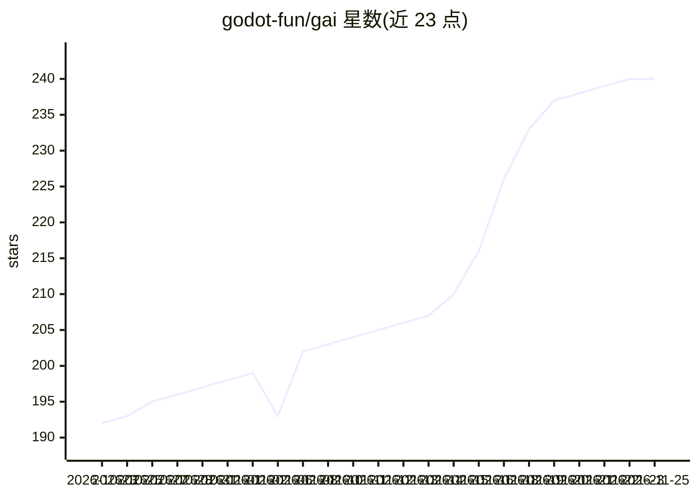

# godot-fun/gai

⭐ 240 · GDScript · MIT · 推送 2026-11-23 · [GitHub](https://github.com/godot-fun/gai) · 个人维护

**用 Godot 游戏引擎构建的桌面 AI 编码 Agent**

整个应用是一个 Godot 场景：以 Agent 循环方式读取代码库、规划、编辑、运行命令与测试、展示 diff 并可用 git 回滚。每轮对话是一个检查点，可恢复单个文件或回滚工作区；后台 Agent 在压缩期间维护 .memory/ 目录的 Markdown 记忆；内置文件树、标签页、Markdown 预览等编辑器功能，支持 Alt+Z 语音听写与改写。本地部署将 Godot、Python、Node.js 与 GGUF 模型放入 .dependency/，聊天可指向 127.0.0.1 不出机器；支持 MCP 接入任意服务器工具，附 36 个资产技能与可复用的 zfoo GDScript 框架。仅支持 Windows 10/11 且需 Git。

## 筛选速览

| 维度 | 判定 | 备注 |
|---|---|---|
| AI 角色 | `ai-native` | 本体是模型或模型工具 |
| 许可风险 | `permissive` | MIT |
| 部署形态 | `None` |  |
| 模型依赖 | local-ok | 支持本地模型 |
| 硬件要求 | — | 无带数字的原话,不猜 |
| 安装摩擦 | `low` | 无编译、无系统依赖或容器化 |
| 成熟度 | — | 结构信号不足 |

## 能力要点

- Agent 循环：读码、规划、编辑、运行测试、diff 与 git 回滚
- 本地部署：GGUF 模型经 llama.cpp 运行，聊天指向 127.0.0.1
- MCP 网关接入任意服务器工具与 36 个资产技能
- 每轮对话为检查点，支持文件级恢复与工作区回滚

## 适用场景

- 让 Agent 端到端完成探索、编辑、验证、审查的编码任务
- 在本地离线运行图像理解与文本聊天模型
- 通过 MCP 把自有服务器工具接入同一对话记录
- 在自己的 Godot 4.6 项目中复用 zfoo 框架模块

## 场景标签

`编码 Agent` · 领域:编码与开发

## 证据(README 行号)

> L5:  An AI coding agent built in Godot.
> L14: > **The loop** — read the code, look things up, change it, run the tests, show the diff, and revert with `git` when
> L17: > **Local deployment** — the engine, runtimes, and GGUF models land in `.dependency/`; point chat at `127.0.0.1` an

## 星数曲线

2026-10-23 192 → 2026-11-25 240（+48）

---
*卡片 v1 · prompt 1.4 · 生成 2026-11-25 · 置信度 high · 依据 README sha `14be98fd909a` · [字段定义](../../DATASET.md)*
