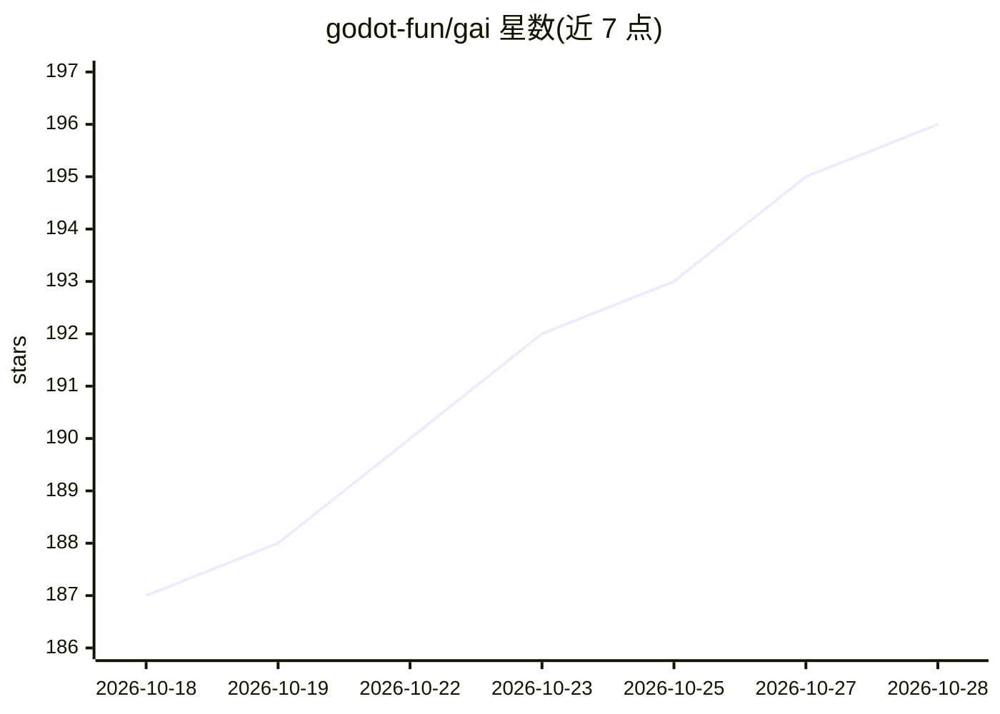

# godot-fun/gai

⭐ 196 · GDScript · MIT · 推送 2026-10-28 · [GitHub](https://github.com/godot-fun/gai) · 个人维护 · 中文 README

**面向 Godot 游戏开发的桌面 AI 编程 agent 与技能工作流框架**

基于 Godot 4.6 构建的一体化 AI 工作区：包含桌面编程 agent（读写/编辑文件、bash、网络搜索等内置工具，模型循环调用直至停止，支持多会话、检查点与回退），以及将仓库技能暴露为节点的可视化工作流编辑器，可组合音频、图像、视频等类型安全端口的批处理流水线。通过 OpenAI 兼容 API 接入模型；技能由 .agents/skills 指令与 .ai 脚本两部分组成，可被桌面 agent、命令行或其他编程 agent（OpenCode/Cursor/Claude 等）复用。附带可复用的 Godot 框架 zfoo 与 godot-cpp GDExtension 支持。

## 筛选速览

| 维度 | 判定 | 备注 |
|---|---|---|
| AI 角色 | `ai-ecosystem` | LLM/agent 周边工具 |
| 许可风险 | `permissive` | MIT |
| 部署形态 | `None` |  |
| 模型依赖 | — | README 未给出锁定关系 |
| 硬件要求 | — | 无带数字的原话,不猜 |
| 安装摩擦 | `low` | 无编译、无系统依赖或容器化 |
| 成熟度 | — | 结构信号不足 |

## 能力要点

- 桌面编程 agent 内置 read/write/edit/bash/web_search 等 10 类工具与模型循环
- 可视化工作流编辑器：技能即节点，类型安全端口与文件夹批处理
- 技能可被桌面 agent、CLI 及 OpenCode/Cursor/Claude 等其他编程 agent 复用
- 提供覆盖 TTS/零样本语音克隆、图像处理、4K 放大等能力的技能目录

## 适用场景

- 在 Godot 桌面界面里让 agent 检查项目、改文件、跑命令和测试
- 用可视化节点搭建可复用的音频/图像/视频资产处理流水线
- 把技能包接入其他编程 agent（如 Claude、Cursor）复用

## 场景标签

`编码 Agent` `工作流自动化` `图像视频处理` `语音合成` · 领域:效率与自动化

## 证据(README 行号)

> L5: GAI brings together a coding agent, reusable skills, command-line tools, and a lightweight Godot framework in one re
> L15: - Run a model loop that calls tools, feeds their results back to the model, and repeats until it stops asking for t
> L107: The root `AGENTS.md` defines shared project conventions. Skills can also be reused with other coding agents that s

## 星数曲线

2026-10-18 187 → 2026-10-28 196（+9）

---
*卡片 v1 · prompt 1.4 · 生成 2026-10-22 · 置信度 high · 依据 README sha `0272e4940b02` · [字段定义](../../DATASET.md)*
