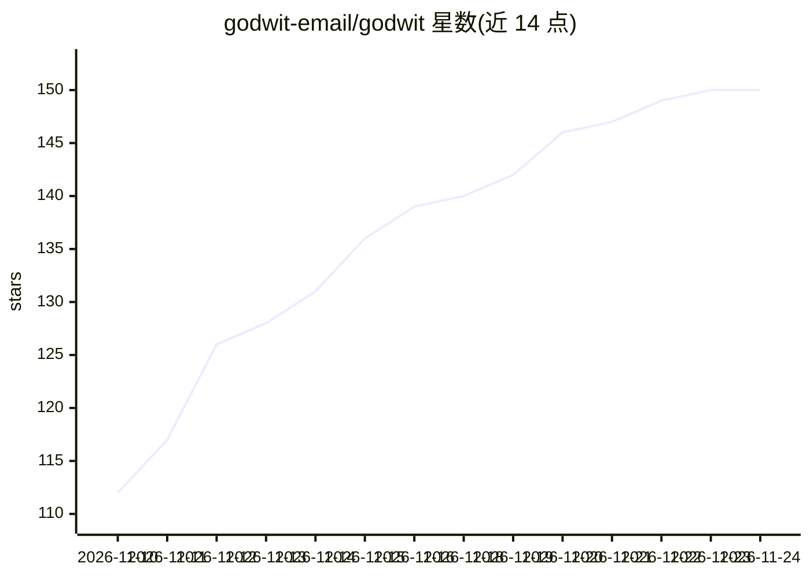

# godwit-email/godwit

⭐ 150 · Go · Apache-2.0 · 推送 2026-11-22 · [GitHub](https://github.com/godwit-email/godwit) · [官网](https://godwit.email) · 组织维护 · 中文 README

**AI 辅助的开源桌面邮件客户端，本地脱敏后再交给模型**

面向个人用户的跨平台（macOS/Windows/Linux）桌面邮件客户端，支持任意 IMAP/SMTP 账户，内置同步、会话、搜索、标签、规则与退订等邮件功能。AI 部分为助手 Wit：阅读与总结邮件、读取附件、起草回复（不代发）。隐私机制是发往云端模型前在本地用识别模型对姓名、账号、电话、密钥等做掩码、警告或拦截并记录日志。支持任意 OpenAI/Anthropic 兼容模型（含 Ollama、LM Studio 本地模型），并可通过 SKILL.md、TypeScript 插件、原生插件与 MCP 服务器扩展。macOS 提供 dmg 与 Homebrew，Windows 提供安装包与商店版，Linux 提供 deb 与安装脚本。

## 筛选速览

| 维度 | 判定 | 备注 |
|---|---|---|
| AI 角色 | `ai-enhanced` | 去掉 AI 部分产品仍成立 |
| 许可风险 | `permissive` | Apache-2.0 |
| 部署形态 | `desktop` | 安装包/桌面程序 |
| 模型依赖 | local-ok | 支持本地模型 |
| 硬件要求 | — | 无带数字的原话,不猜 |
| 安装摩擦 | `low` | 无编译、无系统依赖或容器化 |
| 成熟度 | — | 结构信号不足 |

## 能力要点

- 本地隐私掩码：密钥/证件号/电话/姓名等在送云端模型前被掩码或拦截并留日志
- AI 助手 Wit：问答、读附件（PDF/Office/CSV）、起草回复，外发动作需用户批准
- 支持任意 OpenAI/Anthropic 兼容服务（含 Ollama、LM Studio），密钥存系统钥匙串
- 扩展体系：SKILL.md 技能、TypeScript 插件、原生 C ABI 插件、MCP 服务器及对外 MCP server

## 适用场景

- 用一个客户端管理多个 IMAP/SMTP 邮箱并离线处理邮件
- 让 AI 助手总结邮件、读附件、起草回复，同时敏感信息不原文上云
- 为 Claude、Cursor 等 MCP 应用开放本机邮件读取与草稿创建
- 通过 SKILL.md 和插件扩展自己的邮件工作流

## 场景标签

`AI 助手` · 领域:对话与助手

## 证据(README 行号)

> L11: Godwit is a desktop email client for macOS, Windows and Linux. It works with any IMAP/SMTP account and ships with a
> L22: - **Wit**: an agent that answers questions about your mail, reads attachments (PDF, Office, CSV) and drafts replies

## 星数曲线

2026-11-10 112 → 2026-11-24 150（+38）

---
*卡片 v1 · prompt 1.4 · 生成 2026-11-17 · 置信度 mid · 依据 README sha `125d9ba5a093` · [字段定义](../../DATASET.md)*
