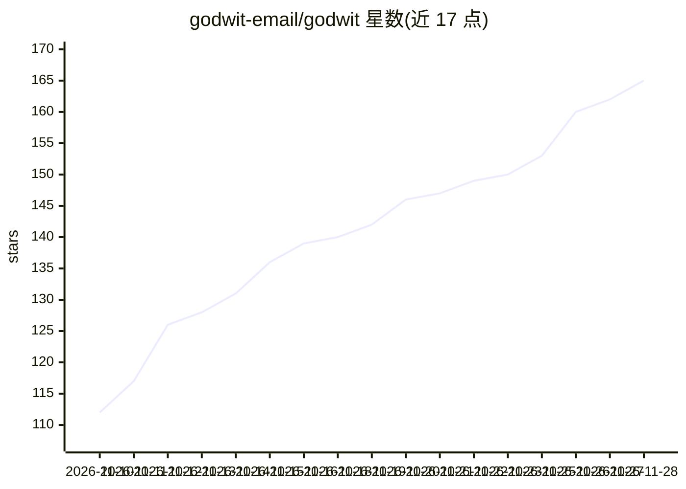

# godwit-email/godwit

⭐ 165 · Go · Apache-2.0 · 推送 2026-11-27 · [GitHub](https://github.com/godwit-email/godwit) · [官网](https://godwit.email) · 个人维护 · 中文 README

**跨平台桌面邮件客户端，本地脱敏后由 AI 摘要、翻译、起草邮件**

基于 Go 与 React 的桌面邮件客户端，支持任意 IMAP/SMTP 账户，内置对 Gmail、Outlook、QQ、163/126、腾讯企业邮、钉钉等服务的自动配置。AI 助手 Wit 可回答邮件问题、读取 PDF/Office/CSV 附件并起草回复，但只写草稿不发送；发往云端模型前在本地用识别模型对姓名、电话、账号、密钥等脱敏。所有 AI 功能走统一的扩展点：SKILL.md 技能、TypeScript 插件、C ABI 原生插件与 MCP 服务器，并提供 godwit mcp 供外部 agent 读写邮件。

## 筛选速览

| 维度 | 判定 | 备注 |
|---|---|---|
| AI 角色 | `ai-enhanced` | 去掉 AI 部分产品仍成立 |
| 许可风险 | `permissive` | Apache-2.0 |
| 部署形态 | `desktop` | 安装包/桌面程序 |
| 模型依赖 | local-ok | 支持本地模型 |
| 硬件要求 | — | 无带数字的原话,不猜 |
| 安装摩擦 | `low` | 无编译、无系统依赖或容器化 |
| 成熟度 | — | 结构信号不足 |

## 能力要点

- 本地脱敏（masking）后才将文本送云端模型，含脱敏日志
- SKILL.md / 插件 / MCP 三层扩展机制，AI 功能与用户扩展同路
- godwit mcp 使 Claude Code、Cursor 等 MCP 应用可读取邮件并创建草稿
- 支持任意 OpenAI/Anthropic 兼容服务及 Ollama、LM Studio 本地模型

## 适用场景

- 在一个客户端集中管理多个 IMAP 邮箱并离线同步
- 让 AI 摘要、翻译邮件并起草回复，敏感信息先在本地遮蔽
- 为个人邮件接入自定义 agent 技能或 MCP 工具
- 在无图形界面的 Linux 服务器上以 systemd 服务后台收信

## 场景标签

`AI 助手` · 领域:对话与助手

## 证据(README 行号)

> L11: Godwit is a desktop email client for macOS, Windows and Linux. It works with any IMAP/SMTP account and ships with a
> L22: - **Wit**: an agent that answers questions about your mail, reads attachments (PDF, Office, CSV) and drafts replies
> L26: - **Your models**: any OpenAI-compatible (Chat Completions or Responses) or Anthropic-compatible service, including

## 星数曲线

2026-11-10 112 → 2026-11-28 165（+53）

---
*卡片 v1 · prompt 1.4 · 生成 2026-11-27 · 置信度 mid · 依据 README sha `2967c85001ff` · [字段定义](../../DATASET.md)*
