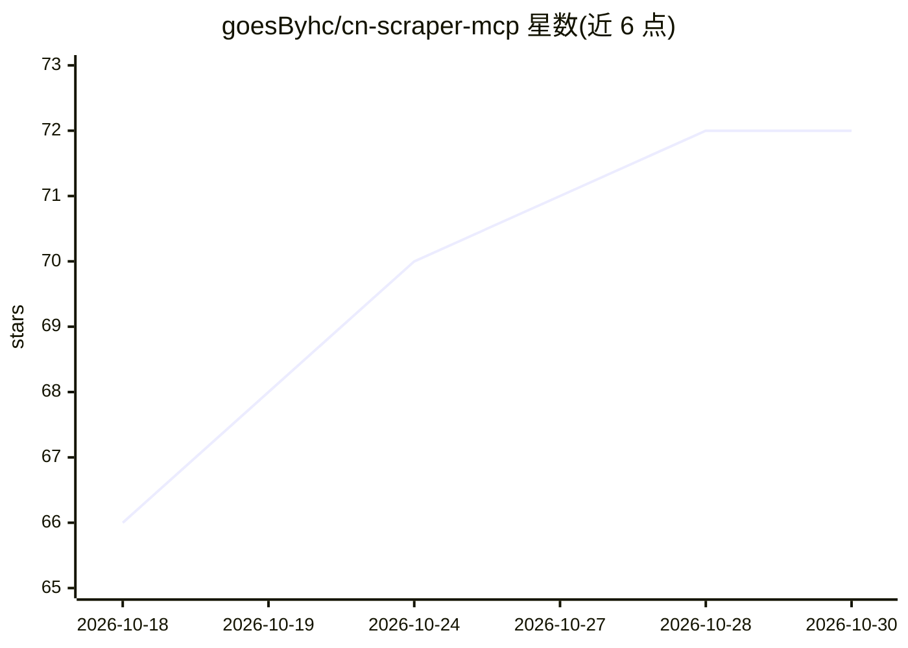

# goesByhc/cn-scraper-mcp

⭐ 72 · Python · MIT · 推送 2026-07-29 · [GitHub](https://github.com/goesByhc/cn-scraper-mcp) · [官网](https://github.com/goesByhc/cn-scraper-mcp) · 个人维护 · 中文 README

**让 AI Agent 搜索中文互联网的 MCP 服务器（淘宝/知乎/B站等10平台）**

面向 Codex、Claude Code、Cursor 等 MCP 客户端的本地 MCP Server，把淘宝、京东、小红书、知乎、微博、B站、知识星球、豆瓣、大众点评等中文平台的搜索/详情/评论封装为 MCP 工具。通过 Chrome CDP 引导登录收割 Cookie（含 HttpOnly），Cookie 保存本机、不上传中转服务器；支持 stdio/HTTP/SSE 三种 transport。提供 pip 安装、Docker 镜像（内置 Chromium）与 Cookie 管理/环境诊断工具。限制：拼多多不推荐、抖音为实验性、小红书需住宅 IP，README 声明仅限学习研究用途。

## 筛选速览

| 维度 | 判定 | 备注 |
|---|---|---|
| AI 角色 | `ai-ecosystem` | LLM/agent 周边工具 |
| 许可风险 | `permissive` | MIT |
| 部署形态 | `self-host` | docker 或自建部署 |
| 模型依赖 | — | README 未给出锁定关系 |
| 硬件要求 | — | 无带数字的原话,不猜 |
| 安装摩擦 | `low` | 无编译、无系统依赖或容器化 |
| 成熟度 | — | 结构信号不足 |

## 能力要点

- 覆盖 10+ 中文平台的搜索/详情/评论 MCP 工具（约 35 个）
- guided_login 通过 Chrome CDP 引导登录并自动收割 Cookie（含 HttpOnly）
- 本地运行，Cookie 不写日志、不通过 MCP 结果返回，凭证只发往平台域名
- 支持 stdio/HTTP/SSE transport 与 Docker 部署（镜像内置 Chromium）

## 适用场景

- 让 Claude Code/Cursor/Codex 等客户端直接搜索淘宝商品或知乎内容
- Agent 查询微博热搜、B站视频与评论等中文平台数据
- 通过 guided_login 扫码登录后抓取需登录态的平台内容

## 场景标签

`网页抓取` · 领域:效率与自动化

## 证据(README 行号)

> L28: **这个项目就是把踩了好几个月的坑打包成一个 MCP Server**——你的 Agent 一句话就能搜：`taobao_search("儿童学习桌")`。
> L14: 每个 AI Agent（Codex、Claude Code、Cursor、Trae）都能搜网页，但中文平台通常需要登录态、浏览器环境或平台专用参数：

## 星数曲线

2026-10-18 66 → 2026-10-30 72（+6）

---
*卡片 v1 · prompt 1.4 · 生成 2026-10-24 · 置信度 high · 依据 README sha `f576a6142e88` · [字段定义](../../DATASET.md)*
