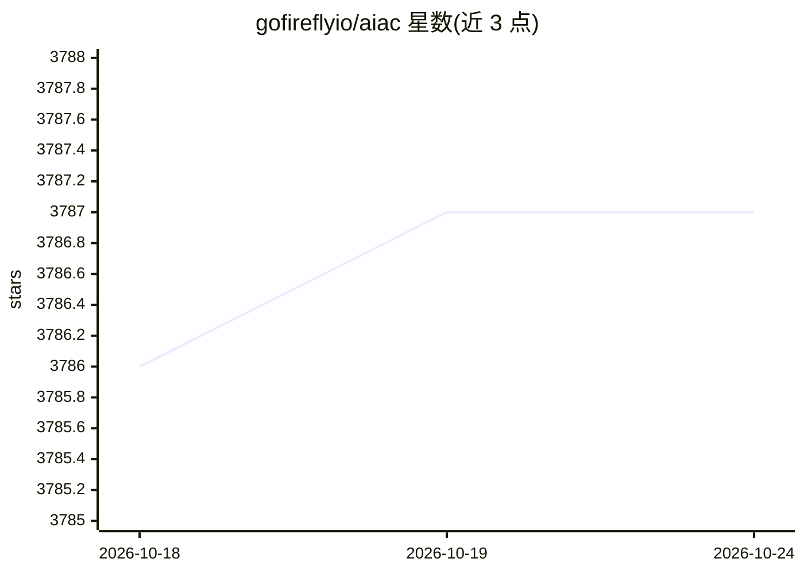

# gofireflyio/aiac

⭐ 3,787 · Go · Apache-2.0 · 推送 2026-03-24 · [GitHub](https://github.com/gofireflyio/aiac) · 组织维护

**用 LLM 生成 IaC 模板与代码的 Go 库和命令行工具**

以 Go 库与 CLI 形式提供，通过 OpenAI、Amazon Bedrock、Ollama 等 LLM 提供方生成 Terraform/Pulumi/CloudFormation 等 IaC 模板，以及 Dockerfile、K8s manifest、CI/CD 流水线、策略、脚本与各类查询语句。通过 TOML 配置文件定义多个命名后端指向不同提供方与环境，生成的代码可打印到标准输出或保存为文件，并提供交互式 shell 支持重试与剪贴板复制。v5 起仅支持 chat 模型、不再硬编码任何模型，可通过 brew、docker、go install 或源码构建安装。

## 筛选速览

| 维度 | 判定 | 备注 |
|---|---|---|
| AI 角色 | `ai-native` | 本体是模型或模型工具 |
| 许可风险 | `permissive` | Apache-2.0 |
| 部署形态 | `self-host` | docker 或自建部署 |
| 模型依赖 | local-ok | 支持本地模型 |
| 硬件要求 | — | 无带数字的原话,不猜 |
| 安装摩擦 | `low` | 无编译、无系统依赖或容器化 |
| 成熟度 | — | 结构信号不足 |

## 能力要点

- 自然语言生成 IaC 模板与配置（Terraform/Pulumi/CloudFormation 等）
- TOML 配置多命名后端，可指向不同 LLM 提供方与环境
- 既可作 CLI 交互式使用，也可作 Go 库嵌入
- v5 起不再硬编码模型，--list-models 直接向后端 API 查询

## 适用场景

- 让模型生成 Terraform、Pulumi 等基础设施代码模板
- 生成 Dockerfile、K8s manifest 与 CI/CD 流水线配置
- 生成 bash/python 实用脚本或 SQL/Mongo/Elastic 查询语句

## 场景标签

`代码生成` · 领域:编码与开发

## 证据(README 行号)

> L13: `aiac` is a library and command line tool to generate IaC (Infrastructure as Code)
> L17: The CLI allows you to ask a model to generate templates for different scenarios
> L19: selected provider, and stores the resulting code to a file, and/or prints it to

## 星数曲线

2026-10-18 3,786 → 2026-10-24 3,787（+1）

---
*卡片 v1 · prompt 1.4 · 生成 2026-10-20 · 置信度 high · 依据 README sha `8569a20db24a` · [字段定义](../../DATASET.md)*
