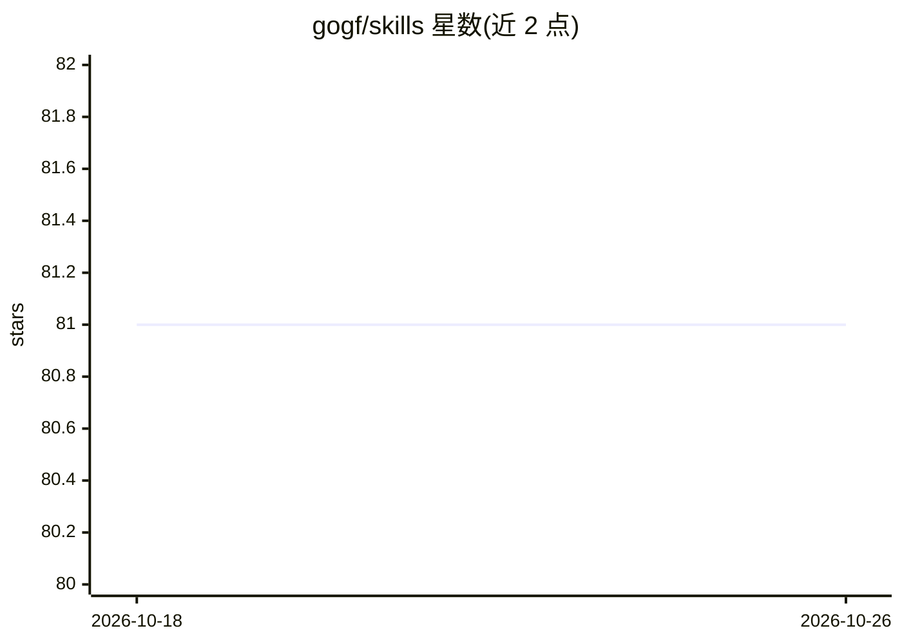

# gogf/skills

⭐ 81 · Go · 推送 2026-06-05 · [GitHub](https://github.com/gogf/skills) · 组织维护

**面向 AI 的 GoFrame 框架技能集：让 AI 生成准确的 GoFrame 代码**

GoFrame 官方团队维护的 AI 技能集，内容覆盖 CLI 管理、配置、日志、错误处理、数据库 ORM 等核心组件的设计概述、用法指南、实践与注意事项，并包含 HTTP 服务、gRPC 微服务等项目类型的代码示例。通过 npx skills add 命令安装到支持 skills 机制的 AI 编码代理（如 Claude、Copilot）中，使模型按 GoFrame 约定生成代码。README 声明当前处于 Beta 阶段，建议使用 Claude Opus 4.6 或更新版本。

## 筛选速览

| 维度 | 判定 | 备注 |
|---|---|---|
| AI 角色 | `ai-knowledge` | 知识聚合/清单类 |
| 许可风险 | `none` | — |
| 部署形态 | `library` | 以包/库形式分发 |
| 模型依赖 | — | README 未给出锁定关系 |
| 硬件要求 | — | 无带数字的原话,不猜 |
| 安装摩擦 | `low` | 无编译、无系统依赖或容器化 |
| 成熟度 | `idea` | |

## 能力要点

- 覆盖 GoFrame 核心组件的文档与最佳实践
- 含 HTTP 服务与 gRPC 微服务等项目类型的代码示例
- 通过 npx skills 命令安装、检查与更新

## 适用场景

- 让 AI 编码代理按 GoFrame 约定生成项目代码
- 在已有 GoFrame 项目中让 AI 添加 JWT 认证等新功能
- 为 AI 提供 GoFrame ORM、日志等组件的用法参考

## 场景标签

`代码生成` `提示工程` · 领域:Agent 开发

## 证据(README 行号)

> L3: GoFrame Skills is an AI skill set tailored for the GoFrame framework, designed to enable AI to produce accurate GoFr
> L5: - 📚 **Comprehensive Documentation**: Covers core components including CLI management, configuration, logging, error 
> L7: - 🤖 **AI-Powered Development**: Empowers AI to deeply understand GoFrame conventions and best practices, generating 

## 星数曲线

2026-10-18 81 → 2026-10-26 81（+0）

---
*卡片 v1 · prompt 1.4 · 生成 2026-10-24 · 置信度 high · 依据 README sha `f88c90c4fe18` · [字段定义](../../DATASET.md)*
