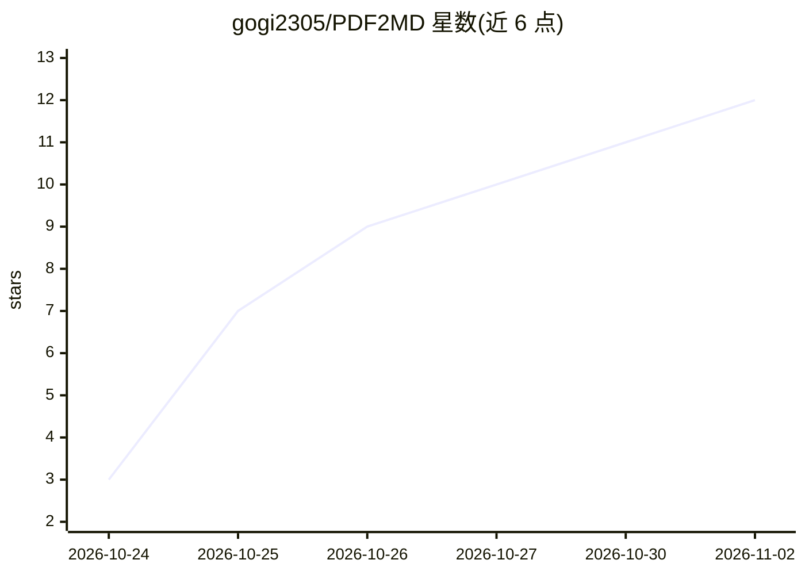

# gogi2305/PDF2MD

⭐ 12 · Python · MIT · 推送 2026-10-12 · [GitHub](https://github.com/gogi2305/PDF2MD) · 个人维护 · 中文 README

**桌面应用：批量把文档转 Markdown 并检索问答（带引用）**

基于 Tkinter 的桌面应用（Windows/Linux/macOS），将 PDF、扫描件、TIFF、照片及 ZIP/RAR/7z 归档批量转为 Markdown：数字 PDF 走文本层，扫描件通过 LlamaParse、Gemini、Mistral OCR 或 GLM-OCR 做 OCR，办公文件经 MarkItDown 转换。转换后生成质量报告（缺失页、乱码、双引擎交叉核验），并对 Markdown 分块建本地向量索引，问答仅基于检索分块并给出处。Windows 提供免 Python 的 exe，其他平台从源码运行，需 API key（Ollama 本地回答免 key）。

## 筛选速览

| 维度 | 判定 | 备注 |
|---|---|---|
| AI 角色 | `ai-native` | 本体是模型或模型工具 |
| 许可风险 | `permissive` | MIT |
| 部署形态 | `desktop` | 安装包/桌面程序 |
| 模型依赖 | local-ok | 支持本地模型 |
| 硬件要求 | — | 无带数字的原话,不猜 |
| 安装摩擦 | `low` | 无编译、无系统依赖或容器化 |
| 成熟度 | — | 结构信号不足 |

## 能力要点

- 支持文件夹与嵌套 ZIP/RAR/7z 归档的批量转换，OCR 结果缓存
- 质量报告标记丢失页、乱码与双 OCR 引擎分歧，附页数核对
- 本地向量索引 + 基于检索分块的问答，答案带来源引用
- 四种 OCR 服务可选：LlamaParse / Gemini / Mistral / GLM-OCR

## 适用场景

- 把成堆扫描件、PDF 和归档批量转成 Markdown 存档
- 检查 OCR 转换是否丢了页或产生乱码
- 对转换后的文档提问并获得带来源引用的回答

## 场景标签

`文档解析` `文档问答` · 领域:知识与检索

## 证据(README 行号)

> L7: Desktop app (Tkinter, Windows / Linux / macOS) that turns PDFs, scans, photos and
> L22:  - Scanned PDFs, TIFF scans and photos (JPG/PNG/WEBP) — via OCR: LlamaParse, Google Gemini, Mistral OCR or GLM-OCR
> L26: 3. **Indexes** the Markdown chunks into a local vector index
> L27: 4. **Answers questions** using only the retrieved chunks, with source citations

## 星数曲线

2026-10-24 3 → 2026-11-02 12（+9）

---
*卡片 v1 · prompt 1.4 · 生成 2026-11-02 · 置信度 mid · 依据 README sha `dc2f5e0f37de` · [字段定义](../../DATASET.md)*
