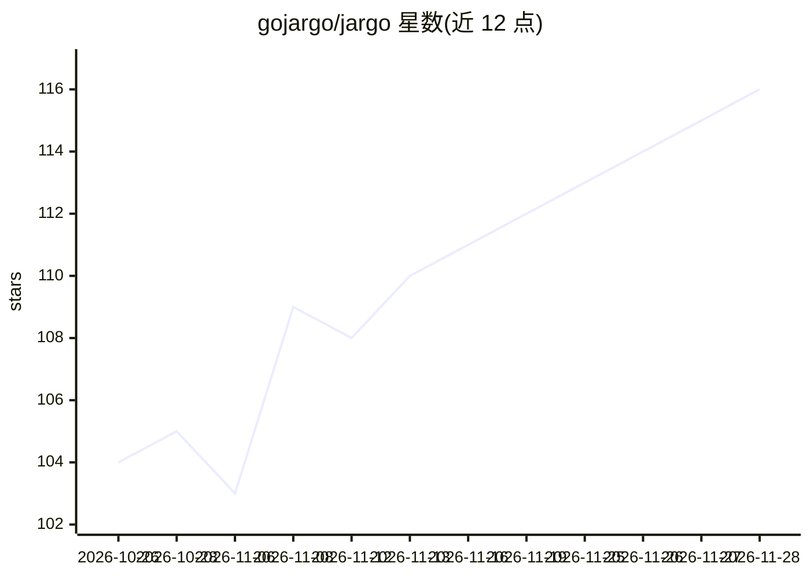

# gojargo/jargo

⭐ 116 · Go · BSD-2-Clause · 推送 2026-11-27 · [GitHub](https://github.com/gojargo/jargo) · [官网](https://gojargo.dev/) · 个人维护

**给 Go 开发者的实时语音 agent 框架：STT→LLM→TTS 流水线**

jargo 是 Go 语言的实时语音 agent 框架，Pipecat 的 Go 移植版。提供 WebRTC（Pion）、WebSocket、LiveKit、电话媒体流等传输层，串起流式 STT→LLM→TTS 或单模型 speech-to-speech 流水线，内嵌 Silero VAD 与 Smart Turn v3（本地 ONNX）实现轮次切换与插话打断。50+ 服务商通过小接口接入可互换；默认构建 cgo-free，输出单个静态二进制；README 附与 Pipecat 的框架开销对比基准。语音机器人运行需运行时加载 ONNX Runtime（打断功能）。

## 筛选速览

| 维度 | 判定 | 备注 |
|---|---|---|
| AI 角色 | `ai-ecosystem` | LLM/agent 周边工具 |
| 许可风险 | `permissive` | BSD-2-Clause |
| 部署形态 | `self-host` | docker 或自建部署 |
| 模型依赖 | local-ok | 支持本地模型 |
| 硬件要求 | — | 无带数字的原话,不猜 |
| 安装摩擦 | `low` | 无编译、无系统依赖或容器化 |
| 成熟度 | — | 结构信号不足 |

## 能力要点

- STT→LLM→TTS 流式流水线与 speech-to-speech 单模型 agent
- Silero VAD + Smart Turn v3 本地 ONNX 实现轮次切换与插话打断，模型内嵌于二进制
- 50+ 服务商接入，STT/LLM/TTS 可独立替换
- 默认 cgo-free 构建，纯 Go 音频处理（Opus 编解码）

## 适用场景

- 用 Go 构建浏览器 WebRTC 实时语音机器人
- 接入 Twilio/Telnyx 等电话媒体流做语音外呼/呼入 agent
- 从 Python/Pipecat 迁移语音 agent 到单二进制部署
- 按项目需要更换 STT/LLM/TTS 服务商组合

## 场景标签

`语音 Agent` `Agent 框架` · 领域:Agent 开发

## 证据(README 行号)

> L13: **jargo** is a framework for real-time voice agents in Go: audio in over WebRTC,
> L73: - **Streaming voice pipeline**: STT → LLM → TTS, with prompt caching and function calling.

## 星数曲线

2026-10-26 104 → 2026-11-28 116（+12）

---
*卡片 v1 · prompt 1.4 · 生成 2026-11-28 · 置信度 high · 依据 README sha `c1598e08c871` · [字段定义](../../DATASET.md)*
