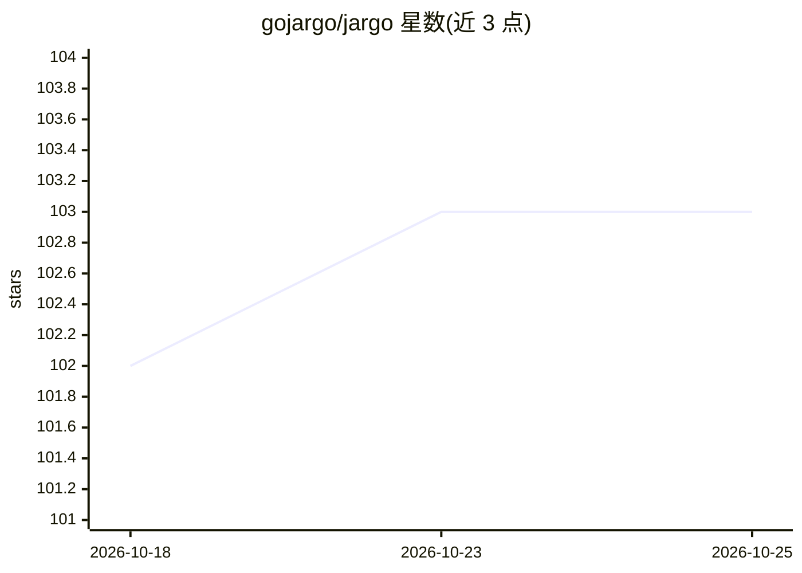

# gojargo/jargo

⭐ 104 · Go · BSD-2-Clause · 推送 2026-10-22 · [GitHub](https://github.com/gojargo/jargo) · 组织维护

**Go 语言的 WebRTC 实时语音 Agent 框架**

用 Go 编写的实时语音对话 Agent 框架，是 Pipecat 的 Go 移植。提供 WebRTC/WebSockets/LiveKit 传输、STT→LLM→TTS 流式管线、语音到语音单模型通道、轮次切换与打断（Silero VAD + Smart Turn，本地 ONNX 并内嵌于二进制）、Twilio 电话接入等。每类服务可插拔替换，STT/LLM/TTS 各支持十余家提供商。默认构建无 cgo，运行时按需加载 ONNX Runtime 与 RNNoise 共享库，Docker 基础镜像内置这些库。

## 筛选速览

| 维度 | 判定 | 备注 |
|---|---|---|
| AI 角色 | `ai-ecosystem` | LLM/agent 周边工具 |
| 许可风险 | `permissive` | BSD-2-Clause |
| 部署形态 | `self-host` | docker 或自建部署 |
| 模型依赖 | local-ok | 支持本地模型 |
| 硬件要求 | — | 无带数字的原话,不猜 |
| 安装摩擦 | `low` | 无编译、无系统依赖或容器化 |
| 成熟度 | — | 结构信号不足 |

## 能力要点

- STT→LLM→TTS 流式语音管线，支持轮次切换与打断
- Silero VAD + Smart Turn v3 以本地 ONNX 运行并内嵌于二进制
- STT/LLM/TTS 各类提供商可插拔替换（LLM 支持 20 家）
- 默认构建无 cgo，编译为单一静态二进制；支持 WebRTC/WebSockets/LiveKit/Twilio 电话

## 适用场景

- 构建实时语音 Agent 服务端，处理多并发会话
- 替换 Python 语音管线，部署为单二进制服务
- 接入 Twilio 做电话外呼/呼入语音机器人

## 场景标签

`Agent 框架` `语音 Agent` · 领域:Agent 开发

## 证据(README 行号)

> L13: **jargo** is a framework for real-time voice agents in Go: audio in over WebRTC,
> L39: - **Streaming voice pipeline**: STT → LLM → TTS, with prompt caching.

## 星数曲线

2026-10-18 102 → 2026-10-25 103（+1）

---
*卡片 v1 · prompt 1.4 · 生成 2026-10-23 · 置信度 high · 依据 README sha `6670a559627c` · [字段定义](../../DATASET.md)*
