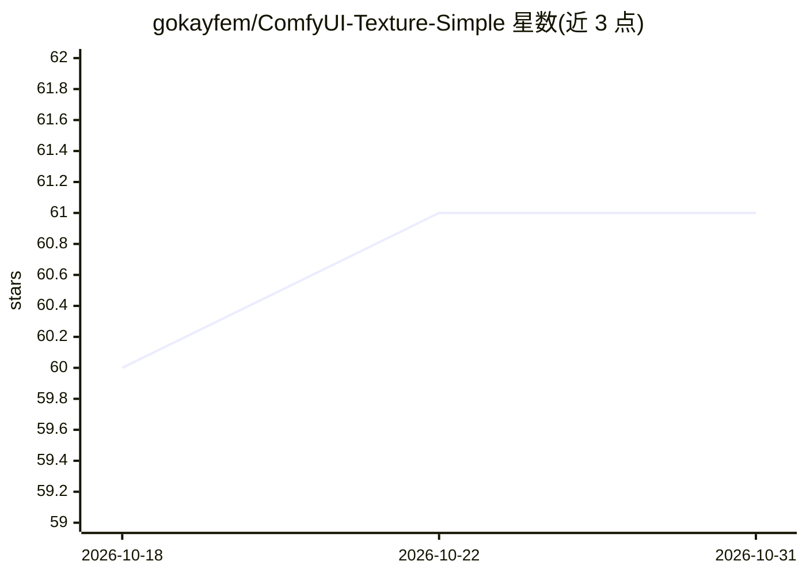

# gokayfem/ComfyUI-Texture-Simple

⭐ 61 · Python · GPL-3.0 · 推送 2026-08-01 · [GitHub](https://github.com/gokayfem/ComfyUI-Texture-Simple) · 个人维护

**ComfyUI 离线 PBR 纹理制作与实时材质预览节点包**

面向 ComfyUI 用户的自定义节点集：把图像或高度图转换为法线、AO 等贴图，做无缝平铺校验（2×2 证明与接缝报告）、ORM/RGBA 通道打包、贴图质量分析（范围/裁剪/法线质量），并在 WebGL 交互式 3D 材质上预览（支持内置几何体与本地 GLB/OBJ）。制图节点在 CPU 上用 NumPy/Pillow 运行，预览依赖浏览器 WebGL；兼容 NVIDIA/AMD/Apple Silicon/CPU 环境，图像保留在本地。通过 ComfyUI Manager 或 git clone 手动安装。

## 筛选速览

| 维度 | 判定 | 备注 |
|---|---|---|
| AI 角色 | `ai-ecosystem` | LLM/agent 周边工具 |
| 许可风险 | `viral` | GPL-3.0 |
| 部署形态 | `library` | 以包/库形式分发 |
| 模型依赖 | — | README 未给出锁定关系 |
| 硬件要求 | `cpu-ok` | |
| 安装摩擦 | `low` | 无编译、无系统依赖或容器化 |
| 成熟度 | — | 结构信号不足 |

## 能力要点

- 高度图生成法线/AO 图并做无缝平铺校验与接缝报告
- WebGL 交互式 PBR 材质预览，支持本地 GLB/OBJ 加载与 GLB/GLTF/OBJ 导出
- ORM/RGBA 通道打包与角色感知的贴图质量分析
- 离线运行：本地固定 Three.js 资源，无运行时 CDN 与遥测，图像不上传

## 适用场景

- 在 ComfyUI 工作流中把高度图转成法线/AO 等贴图
- 打包 ORM 通道贴图以适配 glTF 引擎
- 在 3D 预览中实时查看贴图平铺效果并导出材质

## 场景标签

`图像视频处理` · 领域:感知与多模态

## 证据(README 行号)

> L3: A complete offline PBR texture-authoring and live material-validation toolkit for ComfyUI. It turns ordinary images 
> L58: - NVIDIA, AMD/ROCm, Apple Silicon, Intel, and CPU-only ComfyUI installations are supported: authoring nodes use Num

## 星数曲线

2026-10-18 60 → 2026-10-31 61（+1）

---
*卡片 v1 · prompt 1.4 · 生成 2026-10-24 · 置信度 mid · 依据 README sha `60d5ee91b10d` · [字段定义](../../DATASET.md)*
