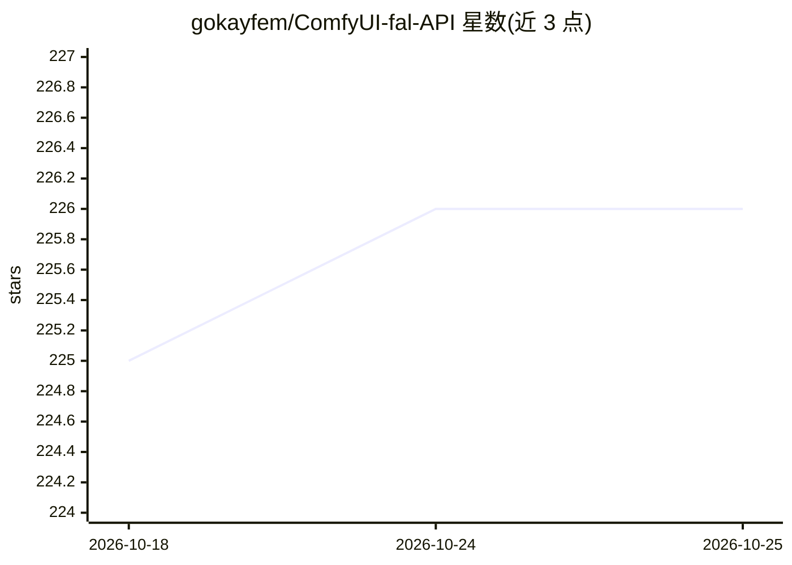

# gokayfem/ComfyUI-fal-API

⭐ 227 · Python · Apache-2.0 · 推送 2026-09-23 · [GitHub](https://github.com/gokayfem/ComfyUI-fal-API) · 个人维护

**将 fal.ai 全目录模型接入 ComfyUI 的自定义节点集**

ComfyUI 自定义节点包，把 fal.ai 平台上约 1,400 个公开模型以节点形式接入：约 90 个手写精选节点加启动时自动生成的节点，覆盖图像、视频、音频、3D、LLM 等。单一 FAL_KEY 配置即可访问全部模型。机制包括持久化结果缓存（相同调用不重复计费）、会话预算与余额守卫、异步执行、URL 直传（中间媒体不落本地）、任务收件箱与溯源回执，以及每日自动更新目录的 GitHub workflow。安装走 ComfyUI Manager 或 git clone 源码，需配置 fal API key。

## 筛选速览

| 维度 | 判定 | 备注 |
|---|---|---|
| AI 角色 | `ai-ecosystem` | LLM/agent 周边工具 |
| 许可风险 | `permissive` | Apache-2.0 |
| 部署形态 | `desktop` | 安装包/桌面程序 |
| 模型依赖 | — | README 未给出锁定关系 |
| 硬件要求 | — | 无带数字的原话,不猜 |
| 安装摩擦 | `low` | 无编译、无系统依赖或容器化 |
| 成熟度 | — | 结构信号不足 |

## 能力要点

- ~90 精选节点 + ~1,400 自动生成节点覆盖 fal 全部公开模型
- 持久化结果缓存与消费守卫（会话预算/余额下限）
- fal→fal URL 直传链路，中间媒体不经过本地
- 每日 GitHub workflow 自动验证并提交新 fal 端点

## 适用场景

- 在 ComfyUI 工作流中直接调用 fal.ai 上的图像/视频/音频模型
- 并行 fan-out 多个 fal 任务并追踪会话成本
- 复用缓存结果避免对相同调用重复付费

## 场景标签

`图像生成` `视频生成` · 领域:内容生成

## 证据(README 行号)

> L5: Custom nodes that bring the entire fal.ai catalog into ComfyUI: ~90 curated hand-written nodes for the most popular 
> L44: Every live public model on fal became a node: ~1,400 auto-generated nodes built at startup from the committed `data

## 星数曲线

2026-10-18 225 → 2026-10-25 226（+1）

---
*卡片 v1 · prompt 1.4 · 生成 2026-10-22 · 置信度 mid · 依据 README sha `f67700fc63d5` · [字段定义](../../DATASET.md)*
