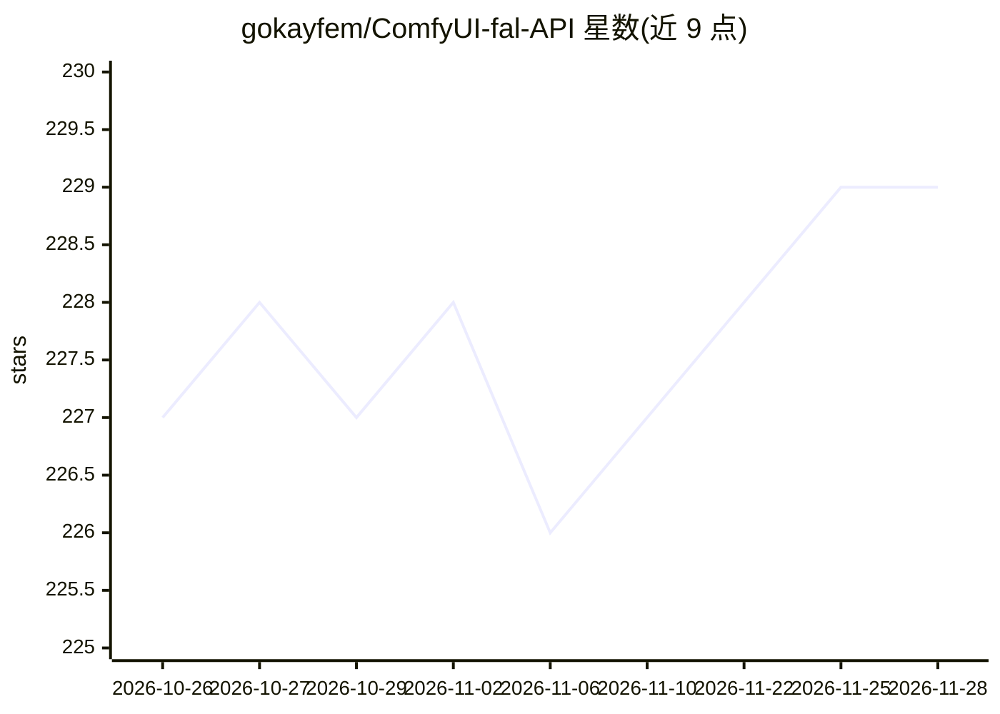

# gokayfem/ComfyUI-fal-API

⭐ 229 · Python · Apache-2.0 · 推送 2026-11-27 · [GitHub](https://github.com/gokayfem/ComfyUI-fal-API) · 个人维护

**将 fal.ai 全量模型接入 ComfyUI 的自定义节点包**

为 ComfyUI 提供的插件集合：约 90 个手写精选节点加约 1,400 个按 fal 注册表自动生成的节点，覆盖 fal.ai 上的图像、视频、音频、3D、LLM 等公开模型，统一使用一个 FAL_KEY 调用。内置持久化结果缓存、会话支出上限守卫、异步并发提交（Submit+Collect）、URL 直传链式调用，以及成本徽章、侧栏余额/任务视图等画布内扩展。模型目录每日由 GitHub workflow 自动刷新，安装依赖 ComfyUI 环境与 fal API key。

## 筛选速览

| 维度 | 判定 | 备注 |
|---|---|---|
| AI 角色 | `ai-ecosystem` | LLM/agent 周边工具 |
| 许可风险 | `permissive` | Apache-2.0 |
| 部署形态 | `desktop` | 安装包/桌面程序 |
| 模型依赖 | — | README 未给出锁定关系 |
| 硬件要求 | — | 无带数字的原话,不猜 |
| 安装摩擦 | `low` | 无编译、无系统依赖或容器化 |
| 成熟度 | — | 结构信号不足 |

## 能力要点

- 约 1,400 个自动生成节点覆盖 fal 全部公开模型，启动时由 fal_registry.json 构建
- 持久化结果缓存与上传去重，相同调用跨重启不重复付费
- Spend guard 会话预算/余额下限守卫与成本估算、会话费用节点
- Fal Submit + Collect 并行扇出，产物附带端点与请求 ID 的溯源凭据

## 适用场景

- 在 ComfyUI 工作流中调用 fal.ai 的图像/视频/音频生成模型
- 批量并行提交视频生成任务并控制 API 花费
- 保存的旧工作流在模型更新后仍可加载运行

## 场景标签

`图像生成` `视频生成` `多模态` · 领域:内容生成

## 证据(README 行号)

> L5: Custom nodes that bring the entire fal.ai catalog into ComfyUI: ~90 curated hand-written nodes for the most popular 
> L48: The recommended installation method is **ComfyUI Manager**: search for
> L73: 1. Get your fal API key from fal.ai

## 星数曲线

2026-10-26 227 → 2026-11-28 229（+2）

---
*卡片 v1 · prompt 1.4 · 生成 2026-11-25 · 置信度 high · 依据 README sha `deff0497f761` · [字段定义](../../DATASET.md)*
