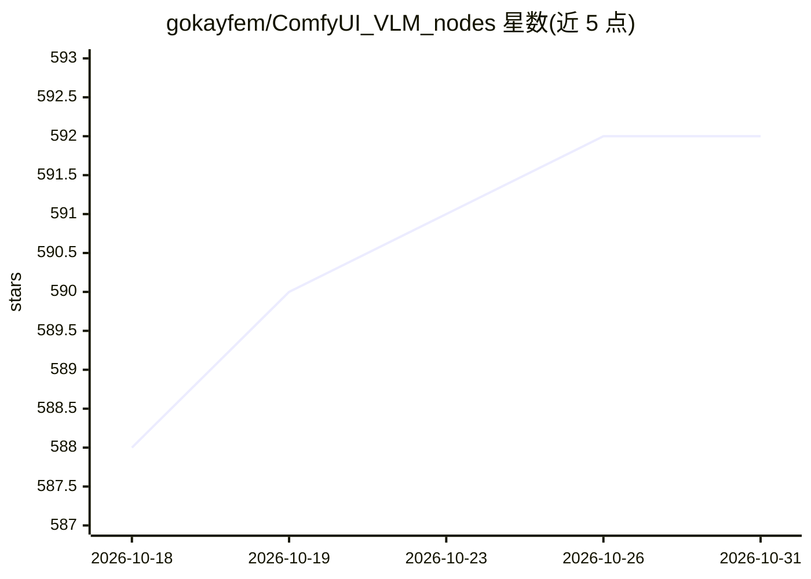

# gokayfem/ComfyUI_VLM_nodes

⭐ 592 · Python · Apache-2.0 · 推送 2026-08-08 · [GitHub](https://github.com/gokayfem/ComfyUI_VLM_nodes) · [官网](https://registry.comfy.org/nodes/comfyui_vlm_nodes) · 个人维护

**ComfyUI 视觉语言模型节点包：图像/视频描述、检测与分割**

面向 ComfyUI 的自定义节点集合，提供 Modern VLM 统一接口（Qwen 3 VL、SmolVLM2、InternVL、Gemma 3 等 12 个策展模型及 Legacy 兼容层），并包含 Florence-2、Moondream、JoyTag、llama.cpp/GGUF 等专项节点。功能覆盖图像/视频描述、OCR、开放词汇检测、分割、跟踪与视频时序推理，输出带版本化 JSON schema 的结构化检测/轨迹/事件数据。另提供文本工具节点、自适应帧采样与像素预算等性能工具，兼容 CUDA/ROCm/Metal/XPU/CPU 设备。

## 筛选速览

| 维度 | 判定 | 备注 |
|---|---|---|
| AI 角色 | `ai-native` | 本体是模型或模型工具 |
| 许可风险 | `permissive` | Apache-2.0 |
| 部署形态 | `desktop` | 安装包/桌面程序 |
| 模型依赖 | local-ok | 支持本地模型 |
| 硬件要求 | — | 无带数字的原话,不猜 |
| 安装摩擦 | `medium` | 含编译或系统依赖之一 |
| 成熟度 | — | 结构信号不足 |

## 能力要点

- Modern VLM 节点以单一接口覆盖 12 个策展 VLM，默认 Qwen 3 VL 2B
- 检测/轨迹/点/事件采用带版本号的 JSON schema 结构化输出
- Florence-2 描述/OCR/检测/分割、Moondream 3 查询与 SVG 分割等专项节点
- 自适应帧采样与像素预算节点在不依赖特定硬件的前提下缩减输入工作量

## 适用场景

- 在 ComfyUI 工作流中为图像/视频生成描述或做视觉问答
- 从图像/视频提取结构化检测框、分割掩码与跟踪轨迹
- 低显存环境下运行 sub-4B VLM 做图像理解

## 场景标签

`多模态` `目标检测` `OCR` · 领域:感知与多模态

## 证据(README 行号)

> L3: Production-oriented vision-language, structured prompting, audio, and utility
> L12: The **Modern VLM** node provides one stable interface with a deliberately
> L102: - **Florence-2**: captioning, OCR, detection, region captioning, and referring

## 星数曲线

2026-10-18 588 → 2026-10-31 592（+4）

---
*卡片 v1 · prompt 1.4 · 生成 2026-10-21 · 置信度 high · 依据 README sha `fc084652891c` · [字段定义](../../DATASET.md)*
