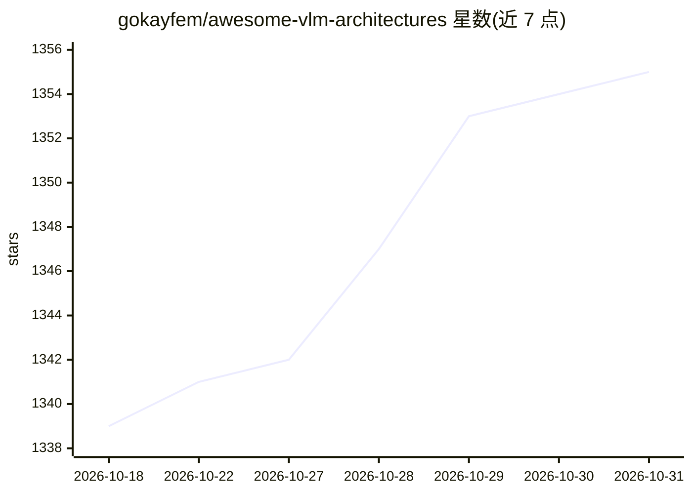

# gokayfem/awesome-vlm-architectures

⭐ 1,355 · Markdown · CC0-1.0 · 推送 2026-10-27 · [GitHub](https://github.com/gokayfem/awesome-vlm-architectures) · 个人维护

**155+ 视觉-语言模型架构的可视化编目清单**

由个人维护的 VLM/MLLM 架构策展目录，收录 155 个模型条目，覆盖对比编码器、多模态 LLM、原生多模态、统一理解生成、视频、OCR、GUI 智能体与具身 AI 等方向。每条目链接原始论文，概述架构、模态对齐/融合、训练阶段、数据集与设计要点，附架构图（如有）。按发布日期提供年表索引与时间线表格（2020 ViT 至 2026 年 7 月），供研究者比较多模态模型家族、追溯架构演进。维护者声明内容为文献指南，主张引用时以原论文为准。

## 筛选速览

| 维度 | 判定 | 备注 |
|---|---|---|
| AI 角色 | `ai-knowledge` | 知识聚合/清单类 |
| 许可风险 | `viral` | CC0-1.0 |
| 部署形态 | `None` |  |
| 模型依赖 | — | README 未给出锁定关系 |
| 硬件要求 | — | 无带数字的原话,不猜 |
| 安装摩擦 | `low` | 无编译、无系统依赖或容器化 |
| 成熟度 | — | 结构信号不足 |

## 能力要点

- 收录 155 个 VLM/MLLM 架构，条目链接原始论文
- 按发布日期组织的时间线索引（含特色贡献列）
- 覆盖 CLIP、Flamingo 等基础系统到当前多模态推理与智能体模型
- 每条目概述架构、模态融合、训练阶段与数据集并附架构图

## 适用场景

- 比较多模态模型家族的架构设计
- 按时间线追溯视觉-语言架构思想的演进
- 为研究或 agent 工作流检索有出处的文献参考

## 场景标签

`精选清单` `科研工具` · 领域:学习与行业

## 证据(README 行号)

> L5: **Awesome VLM Architectures** is a citation-first visual catalog of **155+ Vision-Language Model (VLM/MLLM) architec
> L7: Use this repository to compare multimodal model families, trace architectural ideas over time, or retrieve grounded 

## 星数曲线

2026-10-18 1,339 → 2026-10-31 1,355（+16）

---
*卡片 v1 · prompt 1.4 · 生成 2026-10-21 · 置信度 high · 依据 README sha `43014d372be1` · [字段定义](../../DATASET.md)*
