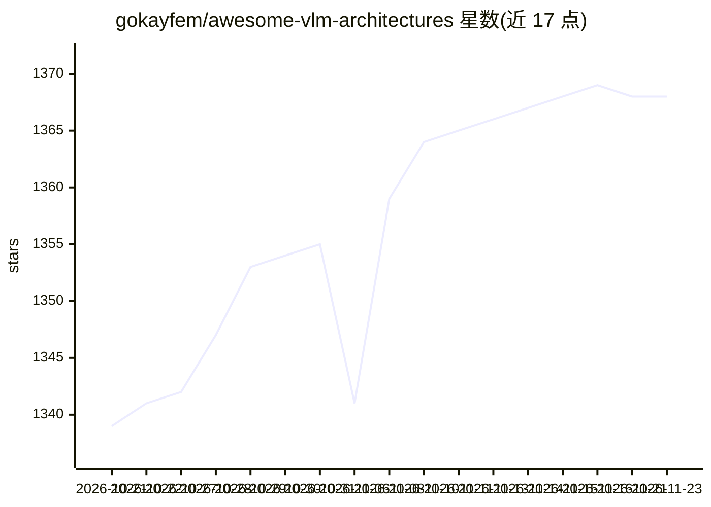

# gokayfem/awesome-vlm-architectures

⭐ 1,368 · Markdown · CC0-1.0 · 推送 2026-10-27 · [GitHub](https://github.com/gokayfem/awesome-vlm-architectures) · 个人维护

**200+ 视觉语言模型架构的策展目录：论文、图示与时间线**

以引用为先的视觉语言模型（VLM/MLLM）架构目录，收录 200 条架构条目，覆盖对比编码器、多模态 LLM、原生多模态模型、统一理解与生成、视频、OCR、GUI agent 与具身 AI。每条条目链接原始论文，概述模型架构、模态对齐或融合方式、训练阶段、数据集与设计取舍，并尽可能附架构图。目录按发布日期倒序组织，提供带来源链接的发布时间线，审核更新至 2026 年 10 月。

## 筛选速览

| 维度 | 判定 | 备注 |
|---|---|---|
| AI 角色 | `ai-knowledge` | 知识聚合/清单类 |
| 许可风险 | `viral` | CC0-1.0 |
| 部署形态 | `None` |  |
| 模型依赖 | — | README 未给出锁定关系 |
| 硬件要求 | — | 无带数字的原话,不猜 |
| 安装摩擦 | `low` | 无编译、无系统依赖或容器化 |
| 成熟度 | — | 结构信号不足 |

## 能力要点

- 收录 200 条 VLM/MLLM 架构条目，每条链接一手来源
- 按发布日期倒序的编年模型索引与发布时间线
- 条目概述架构、模态融合、训练阶段与数据集
- 附 BibTeX 引用信息

## 适用场景

- 对比不同多模态模型家族的架构设计
- 追溯视觉语言模型架构思想的演进脉络
- 为研究写作或 agent 工作流检索有出处的文献参考

## 场景标签

`精选清单` `科研工具` · 领域:学习与行业

## 证据(README 行号)

> L5: **Awesome VLM Architectures** is a citation-first visual catalog of **200 Vision-Language Model (VLM/MLLM) architect
> L7: Use this repository to compare multimodal model families, trace architectural ideas over time, or retrieve grounded 
> L13: October 2026 review: additions since the August 1 review, earlier omissions, family updates, date evidence, and ava

## 星数曲线

2026-10-21 1,339 → 2026-11-23 1,368（+29）

---
*卡片 v1 · prompt 1.4 · 生成 2026-11-23 · 置信度 high · 依据 README sha `76f6b71f138b` · [字段定义](../../DATASET.md)*
