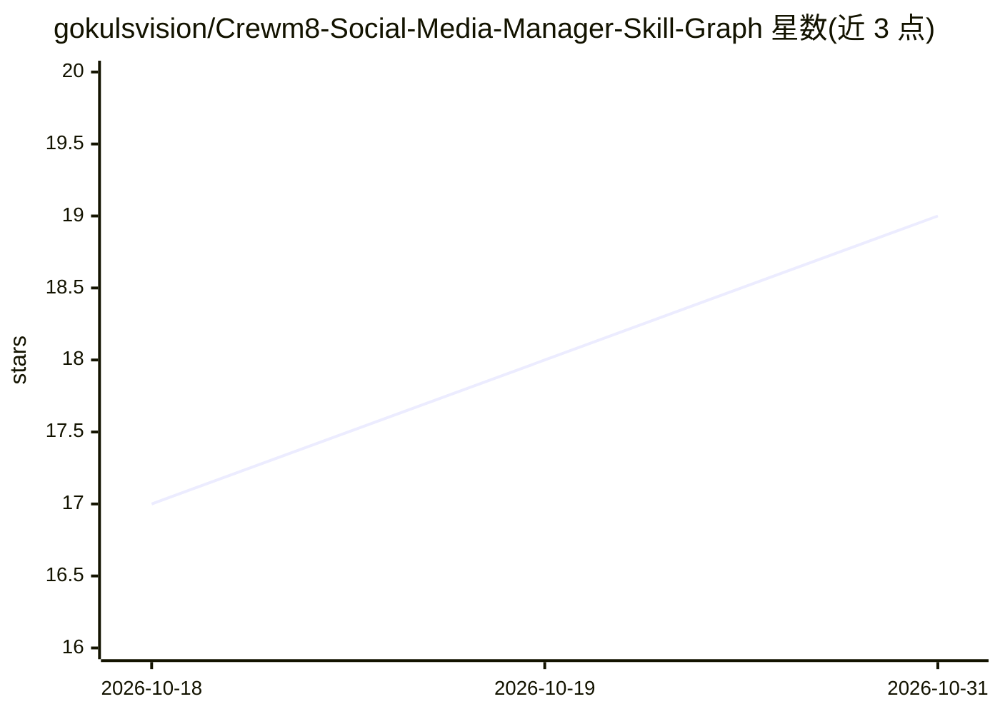

# gokulsvision/Crewm8-Social-Media-Manager-Skill-Graph

⭐ 19 · MIT · 推送 2026-05-01 · [GitHub](https://github.com/gokulsvision/Crewm8-Social-Media-Manager-Skill-Graph) · [官网](https://crewm8.ai) · 组织维护

**37 个社交媒体运营 agent 技能包，覆盖 4 平台 12 类职能**

由 Crewm8 发布的 MIT 开源技能图：37 个独立的 SKILL.md 文件，按策略、规划、创作、复用、互动、分析、危机等 12 类组织，覆盖 X、LinkedIn、Instagram、TikTok 四个平台的运营职能。技能采用通用 YAML 前置格式（name/description/tags），不绑定特定 agent 框架，可被 Hermes Agent、Claude Code、Factory Droid、Cursor、Windsurf、OpenClaw、OpenAI agents 及任意 markdown 技能感知的 agent 加载。技能间可按依赖链组合成周度工作流，附各 agent 的安装指南。

## 筛选速览

| 维度 | 判定 | 备注 |
|---|---|---|
| AI 角色 | `ai-knowledge` | 知识聚合/清单类 |
| 许可风险 | `permissive` | MIT |
| 部署形态 | `None` |  |
| 模型依赖 | — | README 未给出锁定关系 |
| 硬件要求 | — | 无带数字的原话,不猜 |
| 安装摩擦 | `low` | 无编译、无系统依赖或容器化 |
| 成熟度 | — | 结构信号不足 |

## 能力要点

- 37 个 SKILL.md 技能按 12 类组织，每个可独立使用
- 覆盖 X/LinkedIn/Instagram/TikTok 四平台，含平台规格表
- 通用 YAML 前置格式，agent 无关，兼容多主流 agent 框架
- 技能可链式组合为周度内容工作流（趋势→日历→创作→审核→排期→复盘）

## 适用场景

- 为我的 agent 加载一套完整的社媒运营能力
- 让 agent 按周执行内容创作、互动与复盘的链式工作流
- 查找各平台发帖规格与最佳格式参考

## 场景标签

`工作流自动化` `提示工程` · 领域:Agent 开发

## 证据(README 行号)

> L9: 37 discrete, agent-agnostic skills covering every function of startup social media management — from brand strategy 
> L11: - **37 SKILL.md files** organized into 12 categories
> L14: - **Open source:** MIT license. Built by Crewm8. Free for any agent to use.

## 星数曲线

2026-10-18 17 → 2026-10-31 19（+2）

---
*卡片 v1 · prompt 1.4 · 生成 2026-10-29 · 置信度 high · 依据 README sha `5c0b6c17e1fb` · [字段定义](../../DATASET.md)*
