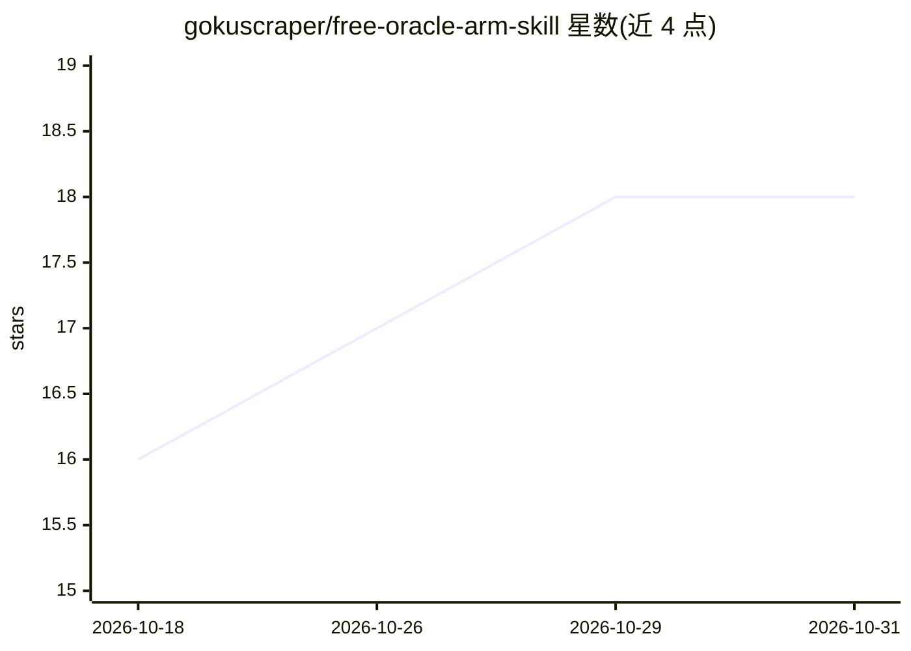

# gokuscraper/free-oracle-arm-skill

⭐ 18 · Shell · MIT · 推送 2026-07-25 · [GitHub](https://github.com/gokuscraper/free-oracle-arm-skill) · 个人维护 · 中文 README

**让 AI 助手自动抢 Oracle 免费 ARM 实例的 agent 技能**

面向 Claude Code、OpenClaw、Cursor、Codex、Gemini CLI 等 AI 助手的 agent skill：由 AI 引导用户从零完成 OCI CLI 安装配置、部署 Shell 抢机脚本，脚本每 60 秒轮询 Oracle Cloud API 直到抢到 Ampere A1（ARM）免费实例（2 OCPU / 12 GB 内存 / 200 GB 存储），抢到后通过 Server酱 推送微信，并内置轻量 CPU 占用脚本降低实例被回收风险。零基础用户按 AI 提示操作即可，脚本需在 Linux 服务器上持续运行（可用甲骨文免费 E2.1.Micro 实例）。

## 筛选速览

| 维度 | 判定 | 备注 |
|---|---|---|
| AI 角色 | `ai-ecosystem` | LLM/agent 周边工具 |
| 许可风险 | `permissive` | MIT |
| 部署形态 | `library` | 以包/库形式分发 |
| 模型依赖 | — | README 未给出锁定关系 |
| 硬件要求 | — | 无带数字的原话,不猜 |
| 安装摩擦 | `low` | 无编译、无系统依赖或容器化 |
| 成熟度 | — | 结构信号不足 |

## 能力要点

- 抢机脚本每 60 秒自动轮询 OCI API，直到成功获取实例
- 抢到后通过 Server酱 实时推送微信通知
- AI 引导完成 OCI CLI 安装、API 密钥配置等全流程
- 内置轻量 CPU 占用功能，降低实例被 Oracle 回收的风险

## 适用场景

- 热门区域手动创建总是 Out of host capacity，想让脚本持续自动重试
- 零基础用户想跟着 AI 一步步领取 Oracle 免费 ARM 实例
- 抢到实例后希望收到微信通知并防止被回收

## 场景标签

`工作流自动化` · 领域:效率与自动化

## 证据(README 行号)

> L21: 一个 **AI agent skill**，让 Claude Code、OpenClaw、Cursor、Codex、Gemini CLI 等 AI 助手具备自动抢 Oracle Cloud 免费 ARM 实例的能力。
> L106:     └── grab_arm.sh       ← 抢机脚本（可直接使用）

## 星数曲线

2026-10-18 16 → 2026-10-31 18（+2）

---
*卡片 v1 · prompt 1.4 · 生成 2026-10-29 · 置信度 high · 依据 README sha `caaac20fe539` · [字段定义](../../DATASET.md)*
