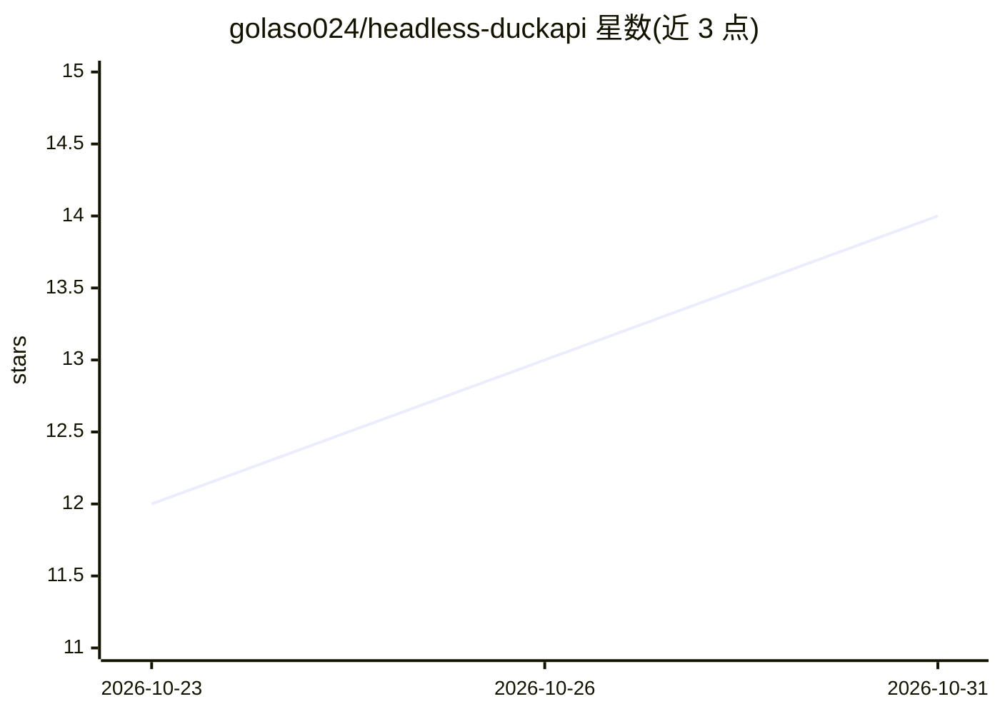

# golaso024/headless-duckapi

⭐ 14 · JavaScript · MIT · 推送 2026-10-20 · [GitHub](https://github.com/golaso024/headless-duckapi) · 个人维护 · 中文 README

**把 duck.ai 免费聊天变成 Telegram AI 机器人的 Node.js 项目**

纯 JS 逆向实现 duck.ai 未公开协议（含反爬 JS 挑战的手工浏览器 mock 求解），无需 API key 或账号，将 GPT/Claude/Mistral 等模型接入 Telegram：流式回答、图片生成、照片识图、Web 搜索开关、SQLite 会话记忆与 Mini App 设置页。代码可运行于 Telegram Serverless 云平台或任意 VPS，提供 Docker 与原生 Node（≥22.5）两种部署方式，协议基于 aurora-develop/Duck2api 移植加固。

## 筛选速览

| 维度 | 判定 | 备注 |
|---|---|---|
| AI 角色 | `ai-ecosystem` | LLM/agent 周边工具 |
| 许可风险 | `permissive` | MIT |
| 部署形态 | `self-host` | docker 或自建部署 |
| 模型依赖 | — | README 未给出锁定关系 |
| 硬件要求 | — | 无带数字的原话,不猜 |
| 安装摩擦 | `low` | 无编译、无系统依赖或容器化 |
| 成熟度 | — | 结构信号不足 |

## 能力要点

- 纯 JavaScript 实现 duck.ai 协议与反爬挑战求解，零 npm 依赖
- 流式回答、/img 图片生成、照片识图、Web 搜索开关
- 挑战令牌与前端版本缓存于 SQLite 以规避 418/429 限流
- 同一代码可跑 Telegram Serverless 云或 VPS（Docker/systemd）

## 适用场景

- 零成本在 Telegram 使用多模型 AI 聊天机器人
- 个人或群组内做问答、识图与图片生成
- 无 VPS 场景下部署到 Telegram Serverless 平台

## 场景标签

`聊天机器人` · 领域:对话与助手

## 证据(README 行号)

> L12: > **headless-duckapi** turns the duck.ai chat (the one DuckDuckGo ships for free, no API key, no account) into a fu
> L35:                  (Bot API, long polling)         (undocumented chat API)
> L115: 1. `GET /duckchat/v1/status` returns `x-vqd-hash-1`: a base64-encoded **JS challenge**.

## 星数曲线

2026-10-23 12 → 2026-10-31 14（+2）

---
*卡片 v1 · prompt 1.4 · 生成 2026-10-31 · 置信度 high · 依据 README sha `0e468aa76448` · [字段定义](../../DATASET.md)*
