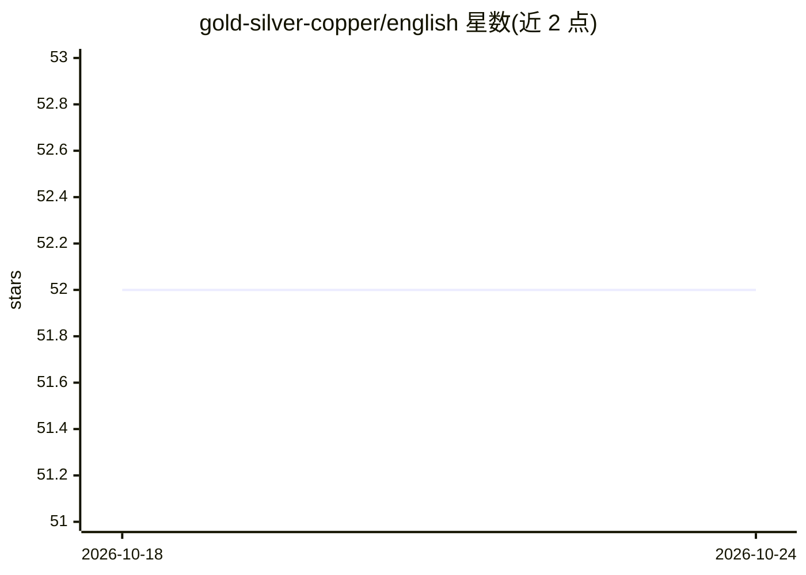

# gold-silver-copper/english

⭐ 52 · Rust · MIT · 推送 2026-08-06 · [GitHub](https://github.com/gold-silver-copper/english) · 个人维护

**Rust 英语屈折变化库：高速生成动词变位与名词/形容词/副词变形**

用 Rust 编写的英语屈折库，总打包数据约 1 MB，从处理的 Wiktionary 数据提供动词变位与名词、形容词、副词变形，面向实时程序化文本生成场景。机制为 PHF 静态表存不规则形式、规则引擎兜底；含独立 crate english-core（纯逻辑无数据）与 extractor 工具（解析约 20 GB Wiktextract dump 生成表）。同形词义以确定性排序编号（lie_2）区分，_n 键在数据刷新时可能重新编号，不建议持久化为稳定 ID。通过 cargo add english 安装。

## 筛选速览

| 维度 | 判定 | 备注 |
|---|---|---|
| AI 角色 | `ai-enhanced` | 去掉 AI 部分产品仍成立 |
| 许可风险 | `permissive` | MIT |
| 部署形态 | `library` | 以包/库形式分发 |
| 模型依赖 | — | README 未给出锁定关系 |
| 硬件要求 | — | 无带数字的原话,不猜 |
| 安装摩擦 | `low` | 无编译、无系统依赖或容器化 |
| 成熟度 | — | 结构信号不足 |

## 能力要点

- PHF 静态表 + 规则兜底的两层屈折架构，单次调用约 90-165 ns
- 从 2026-07-02 Wiktionary dump 生成的不规则形式表
- 确定性同形词义编号（lie_2/die_2），生成可复现
- english-core 可独立使用（无数据依赖的规则近似引擎）

## 适用场景

- 文字游戏/程序化文本生成中实时做名词复数、动词时态变形
- 构建语义三元组与视角敏感的句子渲染领域层（示例 semantic_triples）
- 离线小体积场景下使用 english-core 做规则近似变形

## 场景标签

 · 领域:NLP/形态学工具库

## 证据(README 行号)

> L8: **english** is a fast, lightweight English inflection library written in Rust.
> L10: and noun/adjective/adverb declension from processed Wiktionary data, making it

## 星数曲线

2026-10-18 52 → 2026-10-24 52（+0）

---
*卡片 v1 · prompt 1.4 · 生成 2026-10-24 · 置信度 mid · 依据 README sha `48838d0f5d87` · [字段定义](../../DATASET.md)*
