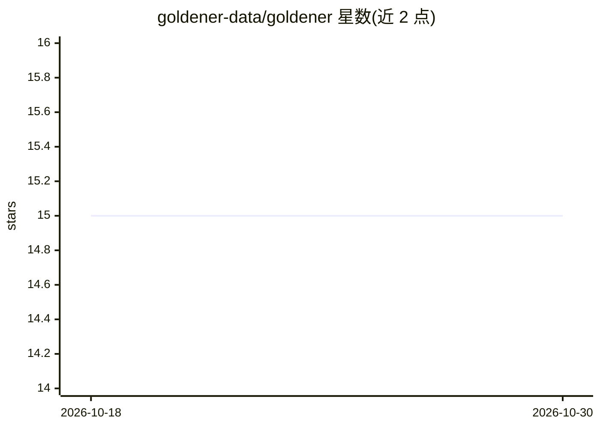

# goldener-data/goldener

⭐ 15 · Python · Apache-2.0 · 推送 2026-10-19 · [GitHub](https://github.com/goldener-data/goldener) · [官网](https://www.goldener.ai/) · 组织维护

**面向 AI 全生命周期的数据编排 Python 库**

Apache 2 许可的开源 Python 库，基于预训练/基础模型提取的嵌入描述数据语义，在 AI 管道全生命周期执行以数据为中心的编排：从未标注数据中选取最具代表性的子集供标注、聚类数据以辅助定义标注规范、按任务变异性切分训练/验证集、训练时均衡批次采样、部署后选取信息量大的数据监测模型与检测分布漂移。支持多模态数据、渐进式批处理、嵌入一次计算多任务复用、任务可分布式执行。基于 PyTorch/numpy/scikit-learn 等标准依赖构建。

## 筛选速览

| 维度 | 判定 | 备注 |
|---|---|---|
| AI 角色 | `ai-ecosystem` | LLM/agent 周边工具 |
| 许可风险 | `permissive` | Apache-2.0 |
| 部署形态 | `library` | 以包/库形式分发 |
| 模型依赖 | — | README 未给出锁定关系 |
| 硬件要求 | — | 无带数字的原话,不猜 |
| 安装摩擦 | `low` | 无编译、无系统依赖或容器化 |
| 成熟度 | — | 结构信号不足 |

## 能力要点

- 以预训练模型嵌入为统一语义表示，覆盖标注、切分、训练、监测各阶段
- 模态无关：适用于文本、图像、视频、表格及多模态数据
- 渐进式批处理与分布式优先：任务可中断重启、结果不重算、可跨多机分布
- 同一嵌入多用途复用，降低计算与资源开销

## 适用场景

- 从未标注数据中挑出最有代表性的子集以降低标注成本
- 训练时均衡批次内容分布以改善欠表示样本的学习
- 模型上线后选取监测数据并检测数据分布漂移
- 聚类数据发现不同模式，为各簇定义标注规范

## 场景标签

`MLOps` · 领域:训练与推理

## 证据(README 行号)

> L21: Goldener is an **open-source Python library** (Apache 2 licence) designed to manage the **orchestration
> L26: It provides tools to orchestrate data during the full lifecycle of Artificial Intelligence pipelines,

## 星数曲线

2026-10-18 15 → 2026-10-30 15（+0）

---
*卡片 v1 · prompt 1.4 · 生成 2026-10-30 · 置信度 high · 依据 README sha `bf3374498fd6` · [字段定义](../../DATASET.md)*
