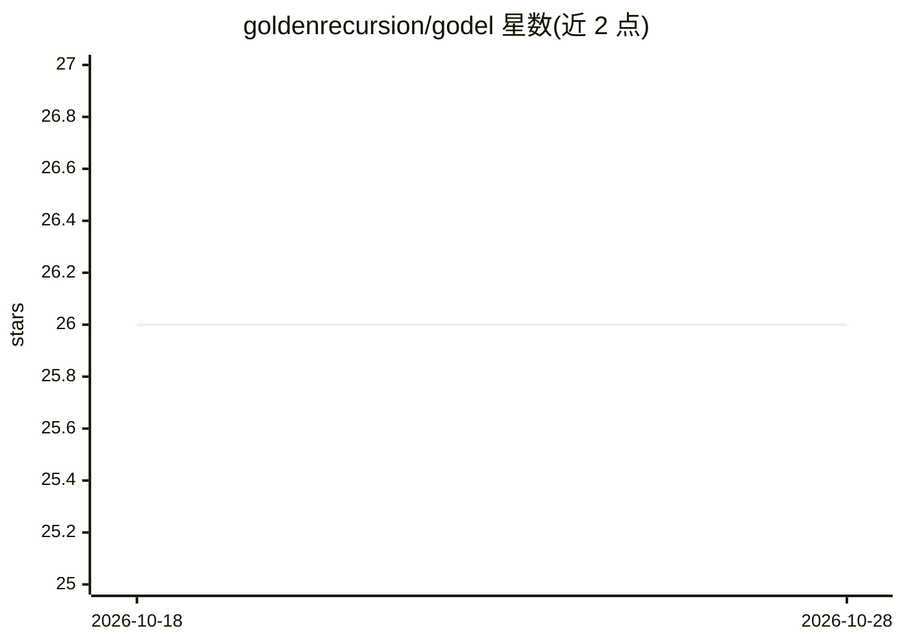

# goldenrecursion/godel

⭐ 26 · Python · Apache-2.0 · 推送 2026-10-24 · [GitHub](https://github.com/goldenrecursion/godel) · [官网](https://docs.golden.xyz/godel-python-sdk) · 组织维护

**Golden 去中心化知识图谱协议的 Python SDK**

Golden 协议的开源 Python SDK，为开发者与 agent 提供构建应用、扩展协议的工具：包含 GraphQL API 封装、数据处理框架与 web3 工具包，支持以编程方式查询与写入去中心化规范化知识图谱。要求 Python 3.7+，通过 pip 安装（可选 web3、data-tools 等扩展），并提供 docker-compose 构建的 Jupyter Lab 环境运行教程。Apache 2.0 许可，由 Golden 团队维护。

## 筛选速览

| 维度 | 判定 | 备注 |
|---|---|---|
| AI 角色 | `ai-ecosystem` | LLM/agent 周边工具 |
| 许可风险 | `permissive` | Apache-2.0 |
| 部署形态 | `self-host` | docker 或自建部署 |
| 模型依赖 | — | README 未给出锁定关系 |
| 硬件要求 | — | 无带数字的原话,不猜 |
| 安装摩擦 | `low` | 无编译、无系统依赖或容器化 |
| 成熟度 | — | 结构信号不足 |

## 能力要点

- GraphQL API 封装查询知识图谱数据
- 数据处理框架与 web3 工具包
- 可选扩展安装 web3/data-tools/jupyter 等组件
- docker-compose 构建 Jupyter Lab 教程环境

## 适用场景

- 以编程方式查询 Golden 知识图谱数据
- 向协议写入/ingest 数据构建应用
- 在 Jupyter 中运行官方教程验证查询与写入流程

## 场景标签

`知识图谱` · 领域:知识与检索

## 证据(README 行号)

> L17: Godel is Golden's open-source Python SDK that will provide developers and agents with the tools and means to build 
> L19: Godel's repository includes a python package and software to help provide developers with an API wrapper, data proc

## 星数曲线

2026-10-18 26 → 2026-10-28 26（+0）

---
*卡片 v1 · prompt 1.4 · 生成 2026-10-26 · 置信度 high · 依据 README sha `9a177b2f507c` · [字段定义](../../DATASET.md)*
