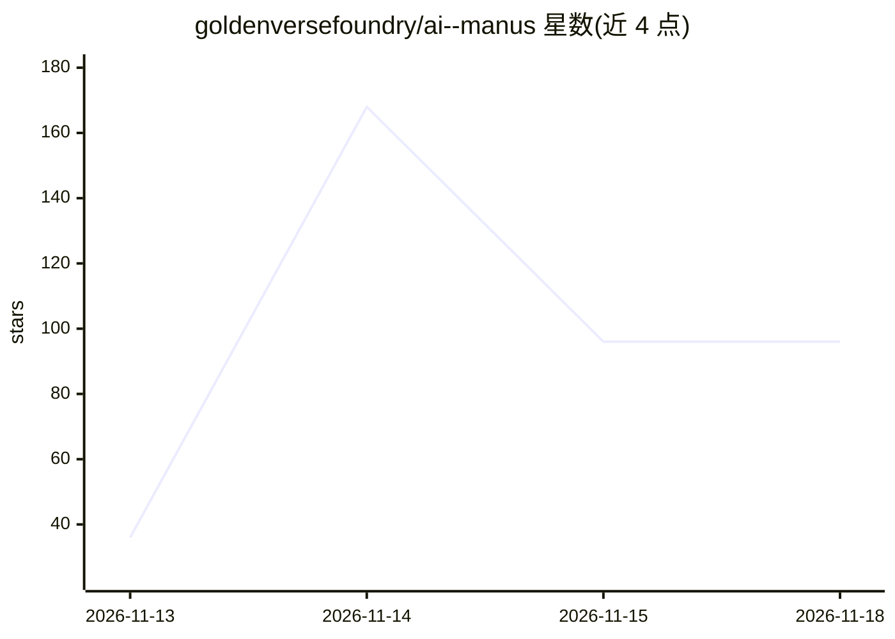

# goldenversefoundry/ai--manus

⭐ 96 · Apache-2.0 · 推送 2026-11-15 · [GitHub](https://github.com/goldenversefoundry/ai--manus) · 个人维护

**面向个人日常任务的自主 AI Agent：跑代码、控浏览器**

自称 Manus 的自主 AI Agent 系统，用户以自然指令委派任务，代理自行编写并执行脚本、控制浏览器完成表单填写与信息收集等多步骤操作，可在脚本与浏览器动作间衔接流程，并宣称跨会话记住工作流模式。定位为家庭、学习与轻量办公场景的小型助手而非企业平台。README 为营销式介绍，未提供具体安装命令、模型接入方式或技术架构说明。

## 筛选速览

| 维度 | 判定 | 备注 |
|---|---|---|
| AI 角色 | `ai-native` | 本体是模型或模型工具 |
| 许可风险 | `permissive` | Apache-2.0 |
| 部署形态 | `None` |  |
| 模型依赖 | — | README 未给出锁定关系 |
| 硬件要求 | — | 无带数字的原话,不猜 |
| 安装摩擦 | `low` | 无编译、无系统依赖或容器化 |
| 成熟度 | — | 结构信号不足 |

## 能力要点

- 自主执行代码与控制浏览器，完成多步骤任务
- 脚本与浏览器动作可在同一流程中衔接
- 宣称跨会话保持一致的任务处理逻辑
- 面向家庭、学习与轻量办公的非开发者用户

## 适用场景

- 委派重复性的网页查资料、填表任务
- 让学生整理研究笔记、跑小脚本
- 远程工作者从多页面收集数据做摘要

## 场景标签

`浏览器自动化` `AI 助手` · 领域:效率与自动化

## 证据(README 行号)

> L18: Manus is an autonomous AI agent designed to run code and control a browser on your behalf. Instead of acting like a
> L22: Manus is not a heavy studio suite or a complex enterprise platform. It is a focused helper built for home, study, a

## 星数曲线

2026-11-13 36 → 2026-11-18 96（+60）

---
*卡片 v1 · prompt 1.4 · 生成 2026-11-17 · 置信度 mid · 依据 README sha `0f78ee3a5dd2` · [字段定义](../../DATASET.md)*
