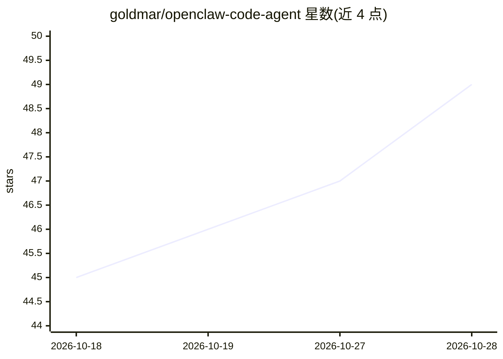

# goldmar/openclaw-code-agent

⭐ 49 · TypeScript · MIT · 推送 2026-10-26 · [GitHub](https://github.com/goldmar/openclaw-code-agent) · [官网](https://www.npmjs.com/package/openclaw-code-agent) · 个人维护

**OpenClaw 插件：把 Claude Code/Codex/OpenCode 变成聊天可控的编码 agent 会话**

openclaw-code-agent（OCA）是 OpenClaw 的有状态编码 agent 插件：将 Claude Code、Codex、OpenCode 作为托管后台会话运行，各后端走各自原生协议（Claude Agent SDK、Codex App Server、OpenCode server API），共享同一套工具与路由。提供计划审批、会话生命周期（挂起/恢复/分叉/中断）、隔离 git worktree、合并与 PR 后续处理、目标循环与成本统计。用户可从 Telegram/Discord 等 OpenClaw 频道发起任务并用按钮审批。需 OpenClaw 2026.10.1 与 Node >=24.16.0 <25 || >=26.1.0；Codex 会话要求 Codex CLI 0.156.1 以上。

## 筛选速览

| 维度 | 判定 | 备注 |
|---|---|---|
| AI 角色 | `ai-ecosystem` | LLM/agent 周边工具 |
| 许可风险 | `permissive` | MIT |
| 部署形态 | `library` | 以包/库形式分发 |
| 模型依赖 | — | README 未给出锁定关系 |
| 硬件要求 | — | 无带数字的原话,不猜 |
| 安装摩擦 | `low` | 无编译、无系统依赖或容器化 |
| 成熟度 | — | 结构信号不足 |

## 能力要点

- 统一编排 Claude Code、Codex、OpenCode 三种编码 agent 后端
- 隔离 git worktree 的完整生命周期与合并/PR/Discard 决策按钮
- 计划审批默认 delegate，实现被阻塞直至批准
- 会话级成本、时长与上下文占用统计（agent_sessions/agent_output/agent_stats）

## 适用场景

- 在 Telegram/Discord 聊天中启动并审批编码 agent 任务
- 让 agent 在隔离 worktree 完成改动后由我决定合并或开 PR
- 跨 Gateway 重启恢复编码会话并查看成本与输出

## 场景标签

`编码 Agent` · 领域:编码与开发

## 证据(README 行号)

> L7: `openclaw-code-agent` (OCA) turns your OpenClaw chat into a control room for real coding agents. Claude Code, Codex,
> L21: - **Multiple harnesses, one control plane**. Claude Code, Codex, and OpenCode share the same tools, routing, notifi

## 星数曲线

2026-10-18 45 → 2026-10-28 49（+4）

---
*卡片 v1 · prompt 1.4 · 生成 2026-10-25 · 置信度 mid · 依据 README sha `3bbbcd6feb3d` · [字段定义](../../DATASET.md)*
