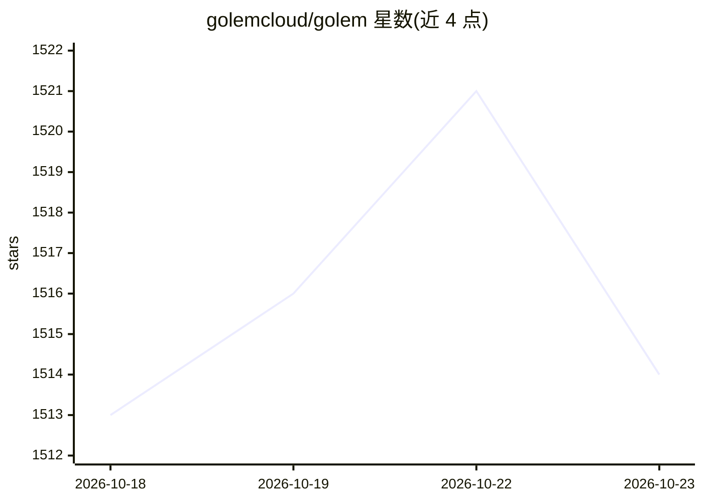

# golemcloud/golem

⭐ 1,514 · Rust · NOASSERTION · 推送 2026-10-22 · [GitHub](https://github.com/golemcloud/golem) · [官网](https://learn.golem.cloud/) · 组织维护

**分布式运行 WebAssembly 组件与构建 agent 的服务平台**

Golem 是一组在分布式云环境中运行 WebAssembly 组件的服务，支持用 Rust、TypeScript、Scala 和 MoonBit 构建应用与 agent，主题标签涉及持久化执行、容错与分布式系统。仓库 README 本身信息较少：入门指引跳转到 Golem Cloud 与开发者文档，本地编译 Golem 服务的方式见贡献指南；docs/ 目录存放基于 Next.js/Nextra 的文档站点源码并由 GitHub Actions 构建部署。具体安装命令与运行细节未在可见 README 中给出。

## 筛选速览

| 维度 | 判定 | 备注 |
|---|---|---|
| AI 角色 | `ai-ecosystem` | LLM/agent 周边工具 |
| 许可风险 | `none` | NOASSERTION |
| 部署形态 | `None` |  |
| 模型依赖 | — | README 未给出锁定关系 |
| 硬件要求 | — | 无带数字的原话,不猜 |
| 安装摩擦 | `low` | 无编译、无系统依赖或容器化 |
| 成熟度 | — | 结构信号不足 |

## 能力要点

- 分布式云环境中运行 WebAssembly 组件的服务集合
- 支持 Rust/TypeScript/Scala/MoonBit 构建 agent
- 文档站点源码位于 docs/（Next.js/Nextra）

## 适用场景

- 在分布式环境中运行 WebAssembly 组件化应用
- 用多语言构建需要持久化执行的 agent
- 查阅文档了解 Golem Cloud 平台的入门与开发

## 场景标签

`Agent 框架` · 领域:Agent 开发

## 证据(README 行号)

> L5: This repository contains Golem - a set of services enable you to run WebAssembly components in a distributed cloud e

## 星数曲线

2026-10-18 1,513 → 2026-10-23 1,514（+1）

---
*卡片 v1 · prompt 1.4 · 生成 2026-10-21 · 置信度 mid · 依据 README sha `5ebdba08c1fc` · [字段定义](../../DATASET.md)*
