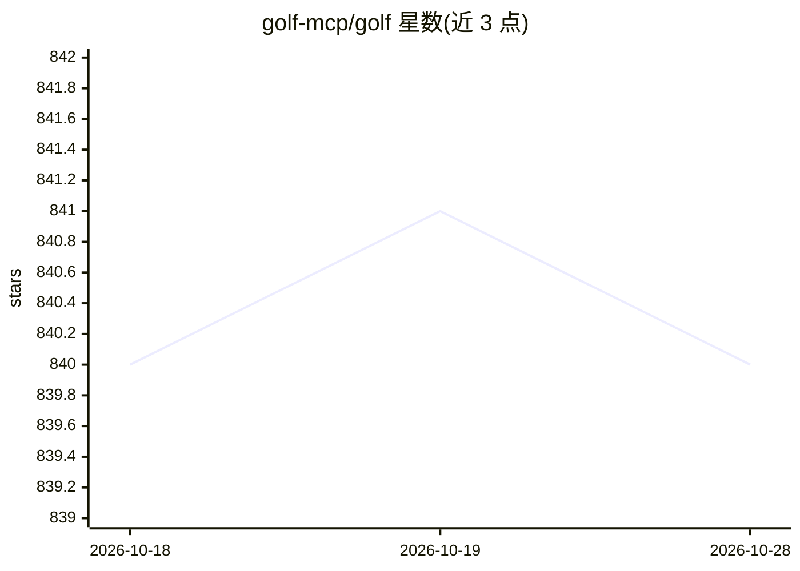

# golf-mcp/golf

⭐ 840 · Python · Apache-2.0 · 推送 2026-09-09 · [GitHub](https://github.com/golf-mcp/golf) · [官网](https://golf.dev/) · 组织维护

**用 Python 文件构建 MCP 服务器的框架，自动发现编译组件**

面向开发者的 MCP 服务器构建框架：将 tools/prompts/resources 定义为约定目录下的 Python 文件，框架自动发现、解析并编译为可运行的 MCP 服务器，目标 FastMCP 4.0.0 与 MCP 2026-07-28 协议。v0.2.0 提供 JWT/OAuth Server/开发令牌认证、LLM 交互内置工具与 OpenTelemetry 遥测集成。通过 pip 安装，CLI 提供 init/build/run 命令，支持 streamable-http 与 stdio 传输（SSE 已弃用）。CLI 收集匿名使用数据，可禁用。

## 筛选速览

| 维度 | 判定 | 备注 |
|---|---|---|
| AI 角色 | `ai-ecosystem` | LLM/agent 周边工具 |
| 许可风险 | `permissive` | Apache-2.0 |
| 部署形态 | `library` | 以包/库形式分发 |
| 模型依赖 | — | README 未给出锁定关系 |
| 硬件要求 | — | 无带数字的原话,不猜 |
| 安装摩擦 | `low` | 无编译、无系统依赖或容器化 |
| 成熟度 | — | 结构信号不足 |

## 能力要点

- Python 文件按目录约定定义 MCP 组件，自动发现与编译
- JWT/OAuth Server/API key/开发令牌认证配置（auth.py）
- OpenTelemetry 遥测集成与 elicitation/sampling 支持
- CLI 脚手架：golf init / build / run

## 适用场景

- 用最少样板代码搭建 MCP 服务器供 AI agent 调用
- 为 MCP 服务器配置企业认证与遥测监控
- 快速原型化并运行 agent 工具、提示与资源

## 场景标签

`Agent 框架` · 领域:Agent 开发

## 证据(README 行号)

> L15: Golf is a **framework** designed to streamline the creation of MCP server applications. It allows developers to def
> L20: With Golf v0.2.0, you get **enterprise-grade authentication** (JWT, OAuth Server, development tokens), **built-in u

## 星数曲线

2026-10-18 840 → 2026-10-28 840（+0）

---
*卡片 v1 · prompt 1.4 · 生成 2026-10-21 · 置信度 high · 依据 README sha `86b203138bb1` · [字段定义](../../DATASET.md)*
