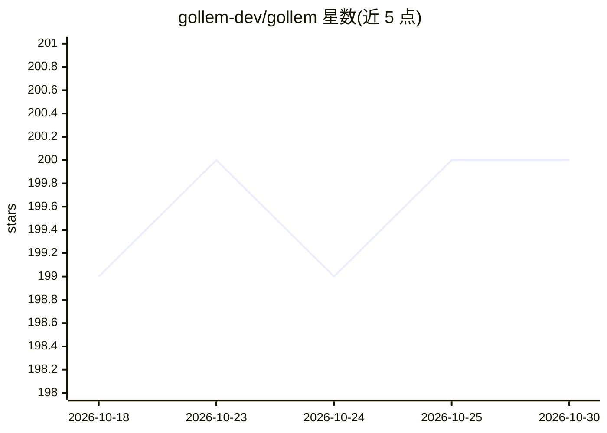

# gollem-dev/gollem

⭐ 200 · Go · Apache-2.0 · 推送 2026-10-28 · [GitHub](https://github.com/gollem-dev/gollem) · 组织维护

**Go 语言的 LLM 统一接口与 agentic 应用构建框架**

面向 Go 开发者的 LLM 应用框架：提供统一接口调用 Gemini、Claude（含 Vertex AI 通道）、OpenAI 与 Ollama，支持文本生成/流式、多模态输入（图像与 PDF）、embedding 与 JSON Schema 约束的结构化输出。Agent 层支持 MCP 工具与自定义工具、自动会话管理、可持久化的对话历史（含自动压缩）、中间件、ReAct/Plan & Execute 执行策略以及 OpenTelemetry 追踪。以 Go 库形式提供，Apache 2.0 许可。

## 筛选速览

| 维度 | 判定 | 备注 |
|---|---|---|
| AI 角色 | `ai-ecosystem` | LLM/agent 周边工具 |
| 许可风险 | `permissive` | Apache-2.0 |
| 部署形态 | `None` |  |
| 模型依赖 | local-ok | 支持本地模型 |
| 硬件要求 | — | 无带数字的原话,不猜 |
| 安装摩擦 | `low` | 无编译、无系统依赖或容器化 |
| 成熟度 | — | 结构信号不足 |

## 能力要点

- 统一接口接入 Gemini/Claude/OpenAI/Ollama，支持流式生成与 embedding
- MCP 工具与自定义工具集成，支持 ReAct 与 Plan & Execute 策略
- JSON Schema 结构化输出，QueryT 单函数调用含自动重试
- 中间件、OpenTelemetry 追踪与可持久化会话历史

## 适用场景

- 用 Go 构建带工具调用的对话式 agent
- 通过 MCP 接入外部工具服务
- 需要 JSON 结构化输出的类型安全 LLM 查询
- 无状态/分布式部署下保持会话历史

## 场景标签

`Agent 框架` `模型网关` · 领域:Agent 开发

## 证据(README 行号)

> L6: - **Common interface** to query prompt to Large Language Model (LLM) services
> L9: - **Framework for building agentic applications** of LLMs with

## 星数曲线

2026-10-18 199 → 2026-10-30 200（+1）

---
*卡片 v1 · prompt 1.4 · 生成 2026-10-23 · 置信度 high · 依据 README sha `f18aa95f13ad` · [字段定义](../../DATASET.md)*
