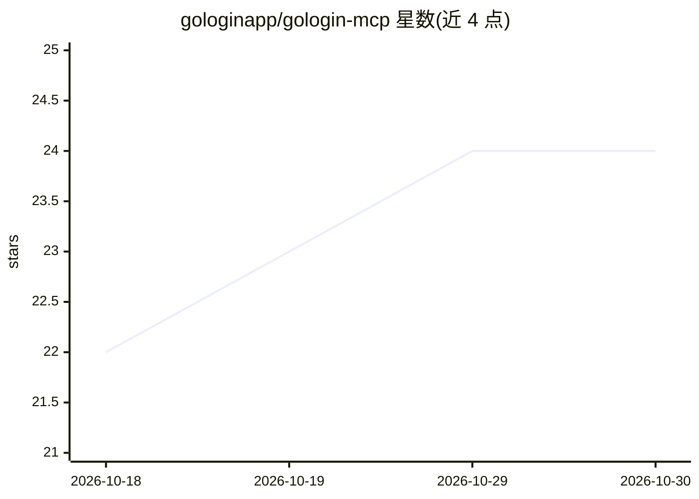

# gologinapp/gologin-mcp

⭐ 24 · TypeScript · MIT · 推送 2026-09-16 · [GitHub](https://github.com/gologinapp/gologin-mcp) · [官网](gologin.com) · 组织维护

**通过 AI 对话管理 GoLogin 浏览器配置文件的 MCP 服务器**

面向使用 MCP 客户端的开发者的 Model Context Protocol 服务器：将 AI 客户端接入 GoLogin API，以工具调用方式创建/读取/更新/删除浏览器 profiles、配置代理、刷新指纹、管理文件夹并启停云端浏览器会话（返回连接 URL）。工具名由 GoLogin OpenAPI 规范在启动时生成，通过 stdio 通信。限制：不提供页面导航、点击、表单填写或本地 Orbita 启动；云端功能依赖账户权限与套餐。需 Node.js 22+、GoLogin 账户与 API token。

## 筛选速览

| 维度 | 判定 | 备注 |
|---|---|---|
| AI 角色 | `ai-ecosystem` | LLM/agent 周边工具 |
| 许可风险 | `permissive` | MIT |
| 部署形态 | `library` | 以包/库形式分发 |
| 模型依赖 | — | README 未给出锁定关系 |
| 硬件要求 | — | 无带数字的原话,不猜 |
| 安装摩擦 | `low` | 无编译、无系统依赖或容器化 |
| 成熟度 | — | 结构信号不足 |

## 能力要点

- 覆盖 profiles、代理、指纹、文件夹、账户信息与云端会话的 CRUD 工具
- 工具名由 GoLogin OpenAPI 规范启动时动态生成
- 支持 Claude Desktop、Cursor 及其他 stdio MCP 客户端
- 以 npx 方式运行，npm 发布含文件允许清单校验

## 适用场景

- 在 Claude Desktop 或 Cursor 中用对话管理 GoLogin 浏览器 profiles
- 批量配置代理或刷新指纹
- 通过 AI 启动云端浏览器会话并获取连接 URL

## 场景标签

 · 领域:浏览器管理/AI 工具集成

## 证据(README 行号)

> L6: Manage GoLogin browser profiles, proxies, fingerprints, folders, and cloud browser sessions through AI conversations
> L95: ### Claude Desktop

## 星数曲线

2026-10-18 22 → 2026-10-30 24（+2）

---
*卡片 v1 · prompt 1.4 · 生成 2026-10-27 · 置信度 high · 依据 README sha `9839f32a4de8` · [字段定义](../../DATASET.md)*
