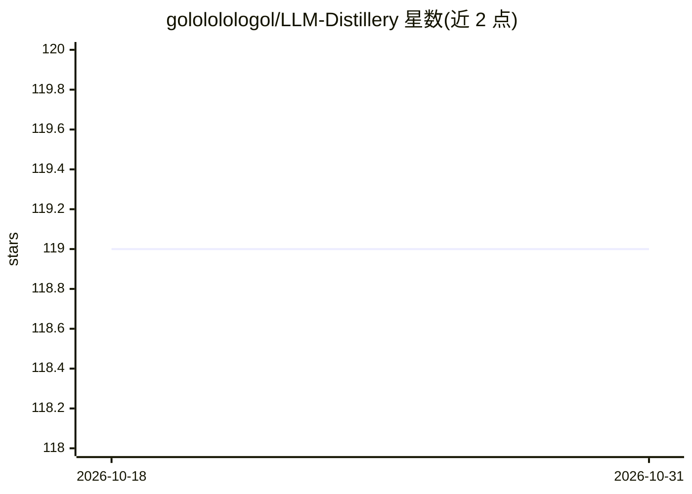

# golololologol/LLM-Distillery

⭐ 119 · Python · Apache-2.0 · 推送 2026-05-07 · [GitHub](https://github.com/golololologol/LLM-Distillery) · 个人维护

**LLM 知识蒸馏流水线：把教师模型蒸馏给学生模型**

用于将一个或多个教师 LLM 蒸馏到学生模型的训练流水线，面向 LLM 训练开发者。支持单/多教师蒸馏、instruct 与 completion 文本两种模式、离线蒸馏（先收集数据集再训练，数据集可分享），并支持 Windows 与 Linux。数据集采用 hdf5 格式自动同步，强制退出后可继续收集；提供温度、设备映射策略等多项可调参数。安装说明指向 Wiki，未在 README 内给出命令。

## 筛选速览

| 维度 | 判定 | 备注 |
|---|---|---|
| AI 角色 | `ai-ecosystem` | LLM/agent 周边工具 |
| 许可风险 | `permissive` | Apache-2.0 |
| 部署形态 | `None` |  |
| 模型依赖 | — | README 未给出锁定关系 |
| 硬件要求 | — | 无带数字的原话,不猜 |
| 安装摩擦 | `low` | 无编译、无系统依赖或容器化 |
| 成熟度 | — | 结构信号不足 |

## 能力要点

- 单教师与多教师蒸馏
- 离线蒸馏：先收集数据集再训练，数据集可分享
- hdf5 数据集自动同步，强制退出后可续采
- 支持 Windows 与 Linux

## 适用场景

- 用大模型生成数据集蒸馏出小模型
- 多教师同时蒸馏到一个学生模型
- 积累并分享蒸馏用训练数据集

## 场景标签

`微调` `模型训练` · 领域:训练与推理

## 证据(README 行号)

> L3: LLM-Distillery is a pipeline for distillation of one or multiple teacher models into a student.
> L6: * Single and Multi-Teacher distillation

## 星数曲线

2026-10-18 119 → 2026-10-31 119（+0）

---
*卡片 v1 · prompt 1.4 · 生成 2026-10-23 · 置信度 high · 依据 README sha `fb039e3e0bbc` · [字段定义](../../DATASET.md)*
