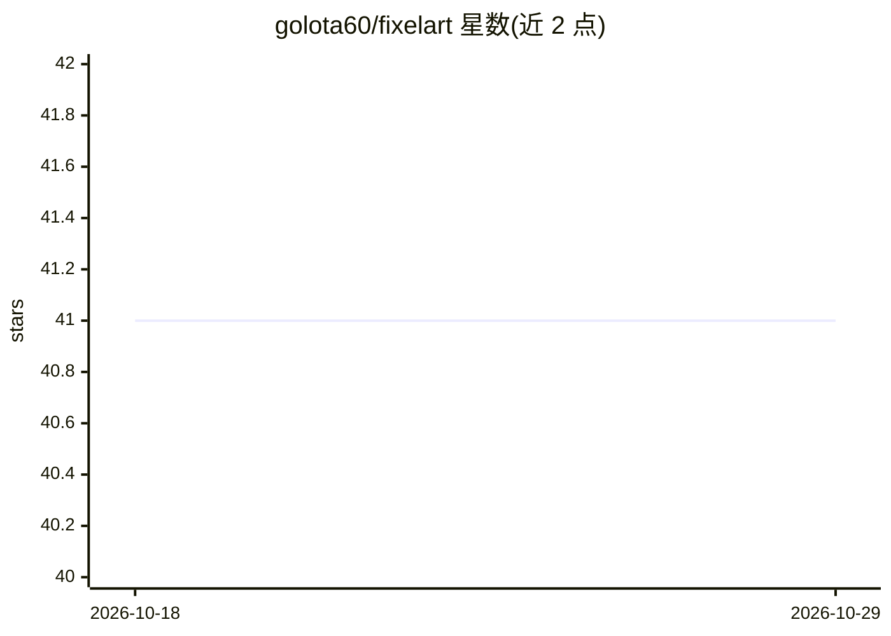

# golota60/fixelart

⭐ 41 · TypeScript · 推送 2026-08-02 · [GitHub](https://github.com/golota60/fixelart) · [官网](https://www.npmjs.com/package/fixelart) · 个人维护

**修正 AI 生成像素画的图像处理工具**

处理 AI 生成的像素画图像的 JavaScript/TypeScript 工具：将图像按指定块尺寸划分，用 17 种颜色聚合策略（多数色、算术/调和/几何/二次/三次均值、百分比混合等）将每块替换为单色，可选 shrink 模式每块输出一个真实像素。提供 npx 直接运行的 CLI 与可导入的 fixImage 库函数；浏览器 Canvas 用法标注为 todo。附带的示例脚本可为测试图像生成全部策略变体。

## 筛选速览

| 维度 | 判定 | 备注 |
|---|---|---|
| AI 角色 | `ai-ecosystem` | LLM/agent 周边工具 |
| 许可风险 | `none` | — |
| 部署形态 | `library` | 以包/库形式分发 |
| 模型依赖 | — | README 未给出锁定关系 |
| 硬件要求 | — | 无带数字的原话,不猜 |
| 安装摩擦 | `low` | 无编译、无系统依赖或容器化 |
| 成熟度 | — | 结构信号不足 |

## 能力要点

- 17 种块级颜色聚合策略（majority、各类均值、ALG05-90 混合策略）
- CLI 与 JS/TS 库两种使用方式，npx 免安装运行
- --shrink 选项每块输出一个真实像素以缩小图像

## 适用场景

- 把 AI 生成的模糊像素画整理为对齐的像素网格
- 批量生成不同聚合策略的像素画变体进行对比
- 在游戏开发流水线中以库形式处理精灵图

## 场景标签

`图像视频处理` · 领域:感知与多模态

## 证据(README 行号)

> L3: A simple utility to fix AI-generated pixelart. Read about how it came to be(and see examples) here or use the playgr
> L9: Fixelart can be run directly as a CLI with `npx`, or installed and imported as a JavaScript/TypeScript library.

## 星数曲线

2026-10-18 41 → 2026-10-29 41（+0）

---
*卡片 v1 · prompt 1.4 · 生成 2026-10-25 · 置信度 high · 依据 README sha `f49e9e4e7fcd` · [字段定义](../../DATASET.md)*
