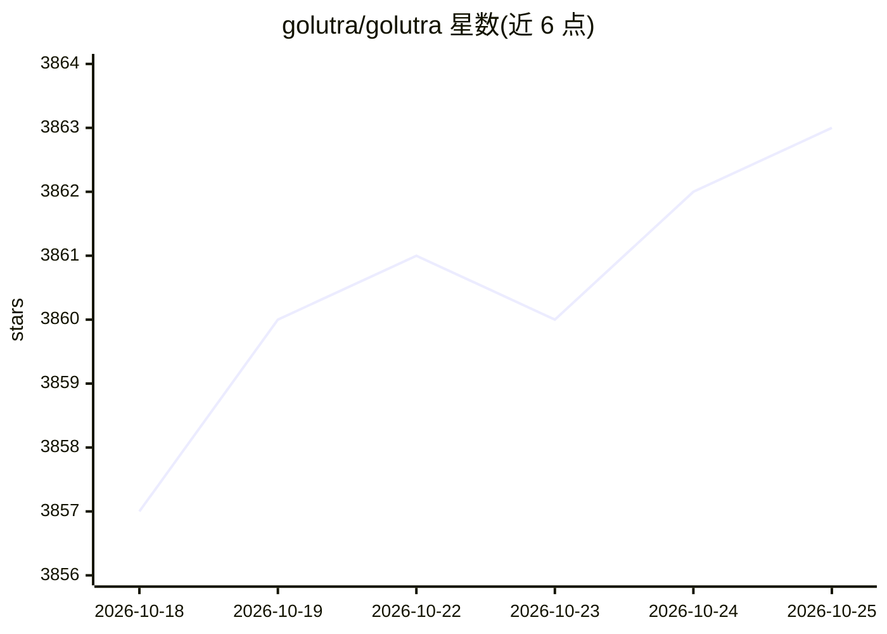

# golutra/golutra

⭐ 3,863 · Rust · NOASSERTION · 推送 2026-09-28 · [GitHub](https://github.com/golutra/golutra) · [官网](https://www.golutra.com) · 个人维护 · 中文 README

**把现有 AI CLI 编排为多智能体并行协作的桌面工作空间**

基于 Vue 3 + Rust 的 Tauri 桌面应用（Windows/macOS/Linux），将 Claude Code、Gemini CLI、Codex CLI、OpenCode、Qwen Code、OpenClaw 及任意 CLI 接入统一的多智能体工作空间：不限数量的并行执行、从分析到部署的自动编排、自定义工作流与模板导入导出、Agent 日志查看与终端流提示词注入、隐形后台终端。可调用 EverOS 作记忆层，golutra-mcp 提供基于 golutra-cli 的 MCP 接入。采用 BSL 1.1 许可，由个人独立开发，README 自述处于早期阶段。

## 筛选速览

| 维度 | 判定 | 备注 |
|---|---|---|
| AI 角色 | `ai-ecosystem` | LLM/agent 周边工具 |
| 许可风险 | `none` | NOASSERTION |
| 部署形态 | `None` |  |
| 模型依赖 | — | README 未给出锁定关系 |
| 硬件要求 | — | 无带数字的原话,不猜 |
| 安装摩擦 | `low` | 无编译、无系统依赖或容器化 |
| 成熟度 | `idea` | |

## 能力要点

- 多智能体并行执行（不限数量）与自动编排
- CLI 兼容层：Claude/Gemini/Codex/OpenCode/Qwen/OpenClaw/任意 CLI
- 自定义工作流与模板一键导入导出
- EverOS 记忆层与 golutra-mcp 的 MCP 接入

## 适用场景

- 把正在用的 AI CLI 组成多人协作团队并行执行任务
- 长期运行的自动化工作流（一人公司、自动写小说、内容发布）
- 在一个界面里跨 CLI 统一调度与状态追踪

## 场景标签

`多智能体` `工作流自动化` · 领域:Agent 开发

## 证据(README 行号)

> L50: golutra is a next-generation multi-agent workspace that transforms your existing CLI tools into a unified AI collab
> L75: - CLI compatibility: Claude, Gemini, Codex, OpenCode, Qwen, OpenClaw, Any CLI

## 星数曲线

2026-10-18 3,857 → 2026-10-25 3,863（+6）

---
*卡片 v1 · prompt 1.4 · 生成 2026-10-20 · 置信度 high · 依据 README sha `31b4bdb9b723` · [字段定义](../../DATASET.md)*
