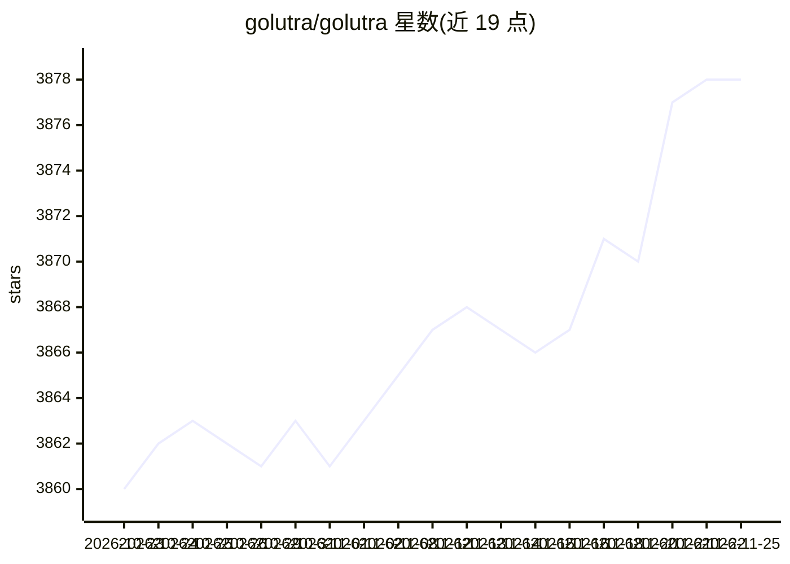

# golutra/golutra

⭐ 3,878 · Rust · NOASSERTION · 推送 2026-11-19 · [GitHub](https://github.com/golutra/golutra) · [官网](https://www.golutra.com) · 个人维护 · 中文 README

**多智能体编排桌面平台：统一调度已有 AI CLI 工具并行协作**

Tauri 桌面应用（Vue 3 + Rust），将用户已有的 CLI Agent 工具（golutra-agent、Claude Code、Codex CLI、Gemini CLI、OpenClaw 等 15 种及自定义 CLI）接入同一工作空间，提供多智能体并行执行、任务派发与状态追踪、可视化日志查看、向终端流注入提示词、自定义工作流及模板一键导入导出，面向长期运行的自动化协作场景。通过 golutra-mcp 可接入 MCP 工作流，可调用 EverOS 作为跨会话记忆层。安装方式为 GitHub Releases 下载，支持 Windows/macOS/Linux。

## 筛选速览

| 维度 | 判定 | 备注 |
|---|---|---|
| AI 角色 | `ai-ecosystem` | LLM/agent 周边工具 |
| 许可风险 | `none` | NOASSERTION |
| 部署形态 | `None` |  |
| 模型依赖 | — | README 未给出锁定关系 |
| 硬件要求 | — | 无带数字的原话,不猜 |
| 安装摩擦 | `low` | 无编译、无系统依赖或容器化 |
| 成熟度 | `idea` | |

## 能力要点

- 接入 15 种 CLI Agent 工具及自定义启动命令，统一编排调度
- 多智能体并行执行，结果自动回传同一工作流
- 自定义工作流，模板一键导入导出
- 配套 golutra-mcp 与 EverOS 记忆层扩展

## 适用场景

- 把多个 AI CLI 工具放进同一界面并行跑任务、统一看日志
- 为一人公司搭建跨任务的自动化 AI 工作流
- 自动化写小说、发布小红书、视频制作等长流程场景

## 场景标签

`多智能体` `工作流自动化` · 领域:Agent 开发

## 证据(README 行号)

> L68: golutra is a next-generation multi-agent workspace that transforms your existing CLI tools into a unified AI collab
> L93: - CLI compatibility: golutra-agent, Claude Code, Antigravity CLI, Codex CLI, Grok CLI, PI, DeepSeek Harness, Hermes

## 星数曲线

2026-10-23 3,860 → 2026-11-25 3,878（+18）

---
*卡片 v1 · prompt 1.4 · 生成 2026-11-23 · 置信度 high · 依据 README sha `2486e048de3e` · [字段定义](../../DATASET.md)*
