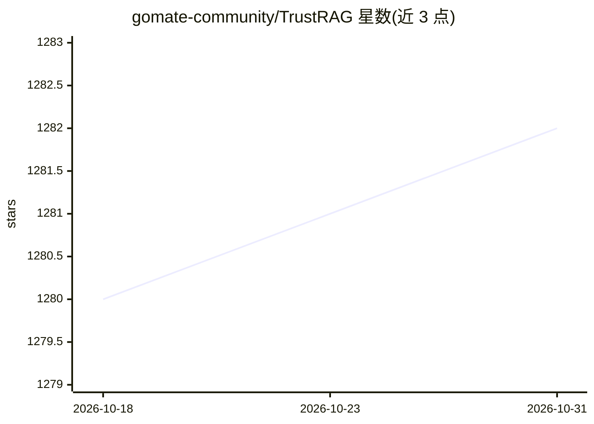

# gomate-community/TrustRAG

⭐ 1,282 · Python · 推送 2026-01-07 · [GitHub](https://github.com/gomate-community/TrustRAG) · [官网](https://gomate-community.github.io/TrustRAG) · 组织维护 · 中文 README

**面向可靠输入可信输出的可配置模块化 RAG 框架**

TrustRAG 是一个 Python 编写的可配置、模块化检索增强生成（RAG）框架，供开发者构建检索问答应用。提供多格式文档解析（text/docx/ppt/excel/html/pdf/md）、BM25+Dense 混合检索、BGE 重排、HyDE 改写、RAPTOR 树检索、Milvus/Qdrant 向量库支持及 GLM-4V 多模态问答；另含 DeepSearch 深度搜索模块，通过意图拆解、递归执行与 answer/reflect/search/read/coding 动作决策生成研究报告。支持 pip 安装与 Docker 部署，由中科院网络数据科学与技术重点实验室 GoMate 团队维护。

## 筛选速览

| 维度 | 判定 | 备注 |
|---|---|---|
| AI 角色 | `ai-ecosystem` | LLM/agent 周边工具 |
| 许可风险 | `none` | — |
| 部署形态 | `self-host` | docker 或自建部署 |
| 模型依赖 | — | README 未给出锁定关系 |
| 硬件要求 | — | 无带数字的原话,不猜 |
| 安装摩擦 | `low` | 无编译、无系统依赖或容器化 |
| 成熟度 | — | 结构信号不足 |

## 能力要点

- BM25+Dense 混合检索与索引构建、增量添加、存储
- DeepSearch 深度搜索：意图拆解、递归执行、多类型动作决策
- 多种 LLM 重排策略（PointWise/PairWise/SetWise）
- 支持 Milvus/Qdrant 向量库与 GLM-4V-Flash 多模态问答

## 适用场景

- 构建可定制组件组合的检索问答系统
- 用 DeepSearch 做深度信息搜索并生成研究报告
- 对本地文档库做解析、切块、检索与重排的 RAG 流水线

## 场景标签

`RAG` `文档解析` `科研工具` · 领域:知识与检索

## 证据(README 行号)

> L14: TrustRAG is a configurable and modular Retrieval-Augmented Generation (RAG) framework designed to provide **reliabl
> L16: The core design of TrustRAG lies in its **high configurability and modularity**, allowing users to flexibly adjust 

## 星数曲线

2026-10-18 1,280 → 2026-10-31 1,282（+2）

---
*卡片 v1 · prompt 1.4 · 生成 2026-10-21 · 置信度 high · 依据 README sha `386046b6280c` · [字段定义](../../DATASET.md)*
