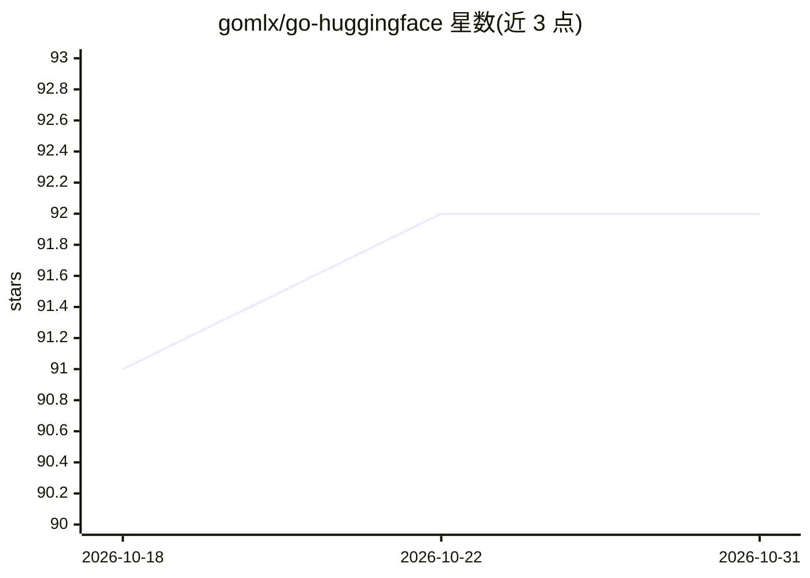

# gomlx/go-huggingface

⭐ 92 · Go · Apache-2.0 · 推送 2026-10-30 · [GitHub](https://github.com/gomlx/go-huggingface) · 组织维护

**Go 语言库：从 HuggingFace Hub 下载模型/分词器/数据集并导入 GoMLX**

面向 Go 开发者的 HuggingFace Hub 工具库，由 GoMLX 团队维护，提供四个相互独立的包：hub（下载模型/数据集文件，与官方 Python 库共享缓存）、tokenizers（含 Go 实现 SentencePiece、句子分桶策略）、models/transformer（实验性，读取模型配置与权重并构建 GoMLX 计算图，支持微调 checkpoint 导出与 //go:embed 嵌入）、datasets（基于 Parquet 的数据集下载与迭代）。自带 hubinfo、dataset_download 等 CLI 工具。模型转换功能标注为 EXPERIMENTAL，覆盖范围持续扩展中。

## 筛选速览

| 维度 | 判定 | 备注 |
|---|---|---|
| AI 角色 | `ai-ecosystem` | LLM/agent 周边工具 |
| 许可风险 | `permissive` | Apache-2.0 |
| 部署形态 | `None` |  |
| 模型依赖 | — | README 未给出锁定关系 |
| 硬件要求 | — | 无带数字的原话,不猜 |
| 安装摩擦 | `low` | 无编译、无系统依赖或容器化 |
| 成熟度 | — | 结构信号不足 |

## 能力要点

- hub 包下载文件并与 HuggingFace 官方库共享缓存格式
- tokenizers 包提供 Go 实现 SentencePiece 分词与句子分桶（Power-of-2/Two-Bits 等策略）
- models/transformer 实验性支持将 HF transformer 模型转为 GoMLX 计算图
- datasets 包支持 Parquet 数据集下载、逐文件流式迭代与自动生成 Go struct

## 适用场景

- 在 Go 项目中直接下载和使用 HuggingFace 模型与数据集
- 用 GoMLX 加载/微调 HF transformer 模型并保存自包含 checkpoint
- 把模型嵌入 Go 二进制实现离线分发
- 用 Rust 版 daulet/tokenizers 做高性能分词（可选）

## 场景标签

`微调` · 领域:训练与推理

## 证据(README 行号)

> L11: Simple APIs for **downloading** (`hub`), **tokenizing** (`tokenizers`), (**experimental**) **model conversion** (`m
> L14: Each component is independent, and only depends on what it needs -- `hub` has no dependency on `GoMLX`, `tokenizers

## 星数曲线

2026-10-18 91 → 2026-10-31 92（+1）

---
*卡片 v1 · prompt 1.4 · 生成 2026-10-23 · 置信度 high · 依据 README sha `06940ec204dc` · [字段定义](../../DATASET.md)*
