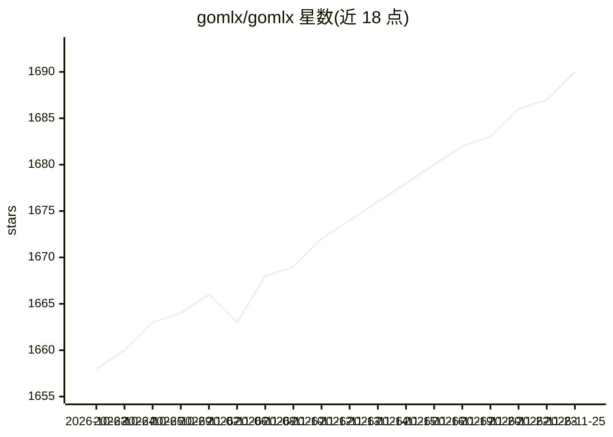

# gomlx/gomlx

⭐ 1,690 · Go · Apache-2.0 · 推送 2026-11-23 · [GitHub](https://github.com/gomlx/gomlx) · 个人维护

**Go 语言机器学习框架：训练/微调/运行模型，多后端加速**

面向 Go 语言的机器学习与通用数学库集合，自述定位类似 Go 版 PyTorch/Jax/TensorFlow，支持模型训练、微调、修改与组合，可读取 HuggingFace 模型。核心机制是定义统一 backend API，由可插拔后端执行计算：纯 Go 后端（可编译至 WASM）、基于 OpenXLA 的 JIT 编译后端（CPU/GPU/TPU、Shardy 分布式）、ONNX Runtime 后端，以及 macOS 的 mps/mlx 后端。提供可微分算子、训练时的指标绘图 UI 工具、PEFT/LoRA 微调包，并附多类训练与推理示例。以 Go 库形式分发，Apache 2.0 许可。

## 筛选速览

| 维度 | 判定 | 备注 |
|---|---|---|
| AI 角色 | `ai-native` | 本体是模型或模型工具 |
| 许可风险 | `permissive` | Apache-2.0 |
| 部署形态 | `self-host` | docker 或自建部署 |
| 模型依赖 | — | README 未给出锁定关系 |
| 硬件要求 | — | 无带数字的原话,不猜 |
| 安装摩擦 | `low` | 无编译、无系统依赖或容器化 |
| 成熟度 | — | 结构信号不足 |

## 能力要点

- 统一 backend API，含纯 Go、OpenXLA、ONNX Runtime、Apple mps/mlx 五种实现
- 纯 Go 后端无 C/C++ 依赖，可编译至 WASM 在浏览器运行
- PEFT/LoRA 微调包：导入即自动注入低秩适配器并冻结基座权重
- 支持 Shardy 多 TPU/多 GPU 分布式执行与 .onnx 模型导出

## 适用场景

- 在 Go 项目中训练或微调机器学习模型
- 读取 HuggingFace 模型做推理（如 LLM 文本生成、NER、图像分割）
- 将模型导出为 .onnx 供其他推理系统使用
- 在浏览器/WASM 环境运行模型推理

## 场景标签

`微调` `模型训练` · 领域:训练与推理

## 证据(README 行号)

> L20: **GoMLX** is an easy-to-use set of Machine Learning and generic math libraries and tools.
> L28: It defines a common "backend" API to run models. It includes a pure Go backend that is portable and also runs in WA
> L122: GoMLX is a friendly "intermediary ML API", that hosts a common API and a library

## 星数曲线

2026-10-23 1,658 → 2026-11-25 1,690（+32）

---
*卡片 v1 · prompt 1.4 · 生成 2026-11-23 · 置信度 mid · 依据 README sha `624e403dc47d` · [字段定义](../../DATASET.md)*
