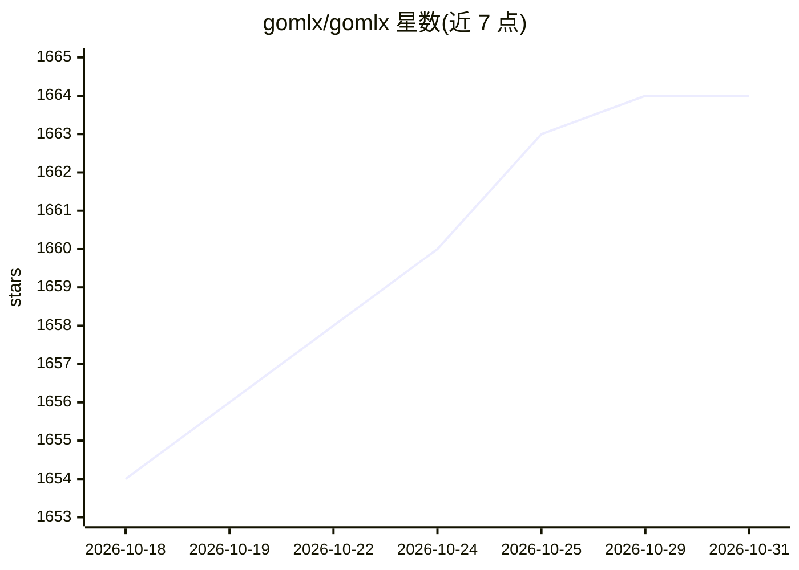

# gomlx/gomlx

⭐ 1,664 · Go · Apache-2.0 · 推送 2026-10-30 · [GitHub](https://github.com/gomlx/gomlx) · 组织维护

**面向 Go 的加速机器学习与数学框架**

GoMLX 是用 Go 编写的机器学习框架，定位为‘Go 版的 PyTorch/Jax/TensorFlow’，支持训练、微调（含零代码改动的 PEFT/LoRA）、修改与组合模型，可从 HuggingFace 读取模型与分词器。它自身不执行计算，而是定义通用后端 API：纯 Go 后端（可编译到 WASM）、基于 OpenXLA 的 xla 后端（CPU/GPU/TPU，即时编译）、以及基于 ONNX Runtime 的 onnx 后端。附训练库、ML 层库、自动微分、checkpoint 检查 CLI 与 JupyterLab Docker 镜像。xla 后端为静态形状，分布式执行仍在改进中。

## 筛选速览

| 维度 | 判定 | 备注 |
|---|---|---|
| AI 角色 | `ai-ecosystem` | LLM/agent 周边工具 |
| 许可风险 | `permissive` | Apache-2.0 |
| 部署形态 | `self-host` | docker 或自建部署 |
| 模型依赖 | — | README 未给出锁定关系 |
| 硬件要求 | — | 无带数字的原话,不猜 |
| 安装摩擦 | `low` | 无编译、无系统依赖或容器化 |
| 成熟度 | `idea` | |

## 能力要点

- 三种后端：纯 Go（WASM 可用）、OpenXLA（CPU/GPU/TPU）、ONNX Runtime
- 零代码改动的 PEFT/LoRA 微调，支持多适配器
- 读取 HuggingFace 模型（GGUF/safetensors）并可用 GoMLX 执行或导出 .onnx
- 配套 GoNB Jupyter 内核、训练绘图与 checkpoint 检查工具

## 适用场景

- 用 Go 原生训练或微调机器学习模型
- 在浏览器中通过 WASM 运行 ML 推理（如游戏 AI）
- 将 HuggingFace/ONNX 模型转换为 GoMLX 执行或进一步微调

## 场景标签

`微调` `模型训练` · 领域:训练与推理

## 证据(README 行号)

> L20: **GoMLX** is an easy-to-use set of Machine Learning and generic math libraries and tools.
> L25: It provides all the tools to make that work easy: from a complete set of differentiable operators,
> L120: GoMLX is a friendly "intermediary ML API", that hosts a common API and a library

## 星数曲线

2026-10-18 1,654 → 2026-10-31 1,664（+10）

---
*卡片 v1 · prompt 1.4 · 生成 2026-10-21 · 置信度 high · 依据 README sha `ad76e4aecb04` · [字段定义](../../DATASET.md)*
