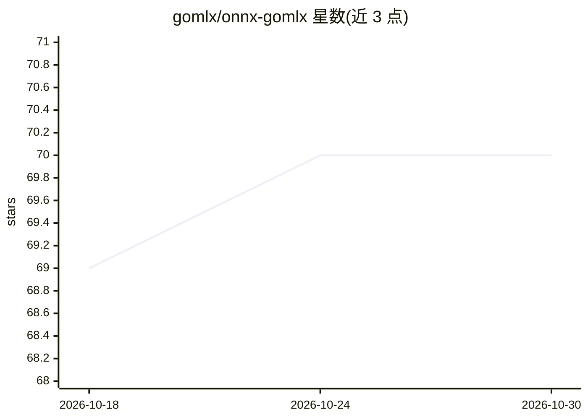

# gomlx/onnx-gomlx

⭐ 70 · Go · Apache-2.0 · 推送 2026-10-29 · [GitHub](https://github.com/gomlx/onnx-gomlx) · 组织维护

**将 ONNX 模型转换为 GoMLX 以便用 Go 推理与微调的库**

提供 ONNX 模型到 GoMLX 框架的转换：导入仅推理的 ONNX 模型后，可利用 GoMLX 的自动微分与训练循环进行微调，并将训练后的权重写回 ONNX 文件；也可直接在 Go 中运行 ONNX 模型而无需引入 ONNX Runtime 或 Python，代价是依赖 XLA/PJRT 后端。支持动态形状后端（go、onnx:cpu），XLA PJRT 后端则将输入填充为固定维度。限制：并非所有 ONNX 算子均已转换，README 称已有约 20 个模型可用。

## 筛选速览

| 维度 | 判定 | 备注 |
|---|---|---|
| AI 角色 | `ai-ecosystem` | LLM/agent 周边工具 |
| 许可风险 | `permissive` | Apache-2.0 |
| 部署形态 | `None` |  |
| 模型依赖 | — | README 未给出锁定关系 |
| 硬件要求 | — | 无带数字的原话,不猜 |
| 安装摩擦 | `low` | 无编译、无系统依赖或容器化 |
| 成熟度 | `idea` | |

## 能力要点

- ONNX→GoMLX 转换，支持导入权重并用 GoMLX 训练循环微调
- 微调后可将变量值写回 ONNX 模型保存（ScopeToONNX）
- 支持动态形状后端（GOMLX_BACKEND=go / onnx:cpu），可变 batch 与序列长度免重编译图
- 可在 GoMLX 中扩展模型的前/后处理（图像变换、归一化、组合模型、集成）

## 适用场景

- 在纯 Go 环境中运行 ONNX 模型，避免引入 ONNX Runtime 或 Python
- 导入 ONNX 模型到 GoMLX 做微调并导出回 ONNX 权重
- 为 ONNX 模型附加自定义前后处理或构建模型集成

## 场景标签

`微调` `推理引擎` · 领域:训练与推理

## 证据(README 行号)

> L7: ONNX-GoMLX converts ONNX models (`.onnx` suffix) to
> L16: 1. **Fine-tuning**: import an inference-only ONNX model to GoMLX and use its auto-differentiation and training loop
> L19: 2. **Inference**: use an ONNX file using Go and not having to include ONNX Runtime (or Python)

## 星数曲线

2026-10-18 69 → 2026-10-30 70（+1）

---
*卡片 v1 · prompt 1.4 · 生成 2026-10-24 · 置信度 high · 依据 README sha `b0c39d569bcd` · [字段定义](../../DATASET.md)*
