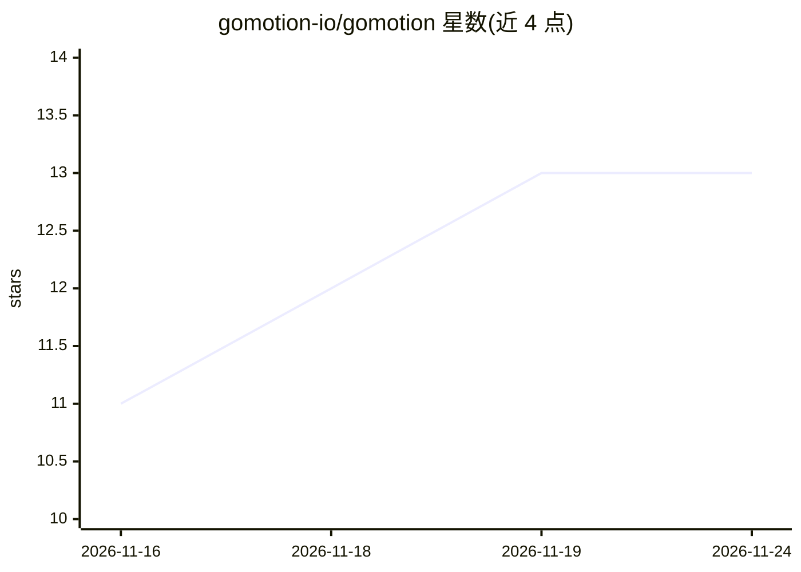

# gomotion-io/gomotion

⭐ 13 · TypeScript · 推送 2026-10-06 · [GitHub](https://github.com/gomotion-io/gomotion) · [官网](https://www.gomotion.io/) · 组织维护

**从单条提示词生成动画视频的动效设计 agent**

基于 Next.js 15 的动效设计 agent：用户输入自然语言提示后，Animator Agent 通过 OpenRouter 与 Vercel AI SDK 生成 Remotion 视频合成代码，经最多 5 次重试的错误反馈自校验循环输出多文件 Remotion 项目，在浏览器中打包预览并完成渲染导出 MP4，全程无服务端渲染。支持 classic/creative/narrative 等上下文模式与 remix 修改流程。要求 Node.js 24 与 pnpm 12.8.1，许可为专有、保留所有权利。

## 筛选速览

| 维度 | 判定 | 备注 |
|---|---|---|
| AI 角色 | `ai-native` | 本体是模型或模型工具 |
| 许可风险 | `none` | — |
| 部署形态 | `self-host` | docker 或自建部署 |
| 模型依赖 | locked-api |  |
| 硬件要求 | — | 无带数字的原话,不猜 |
| 安装摩擦 | `low` | 无编译、无系统依赖或容器化 |
| 成熟度 | — | 结构信号不足 |

## 能力要点

- 自然语言提示生成完整多文件 Remotion 视频项目
- 最多 5 次重试的错误反馈自校验循环
- 导出在浏览器内完成（esbuild-wasm 打包），无服务端渲染
- 通过 OpenRouter 运行，用户在应用设置中填入自己的 key

## 适用场景

- 输入一句话生成动画视频
- 对已有视频提交修改请求进行迭代
- 导出 MP4 视频文件

## 场景标签

`视频生成` · 领域:内容生成

## 证据(README 行号)

> L3: Gomotion is a research-driven motion design agent that creates animated videos from a single prompt using an agentic
> L12: User Prompt → AI Agent → Generated Remotion Code → Browser Bundler → Video Preview → Render Engine → MP4 Export

## 星数曲线

2026-11-16 11 → 2026-11-24 13（+2）

---
*卡片 v1 · prompt 1.4 · 生成 2026-11-18 · 置信度 mid · 依据 README sha `8ead81df5aec` · [字段定义](../../DATASET.md)*
