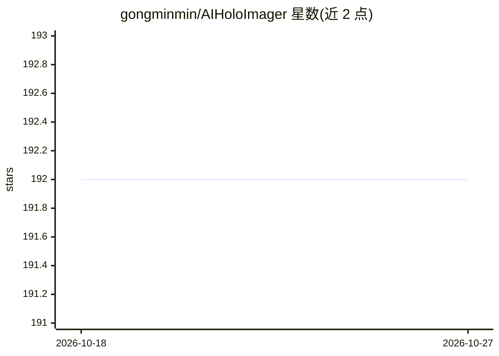

# gongminmin/AIHoloImager

⭐ 192 · C++ · MIT · 推送 2026-10-25 · [GitHub](https://github.com/gongminmin/AIHoloImager) · 个人维护

**从少量照片或视频生成 3D 网格的重建工具（Windows）**

将摄影测量重建流水线拆分为多个阶段，按阶段选择性使用 AI 方法或传统多视图立体重建方法，从少量照片或视频片段生成相对完整的 3D 网格，兼顾可见表面的精确重建与未拍摄区域的补全。目前仅支持 Windows，需用 CMake 生成项目文件并配合 Visual Studio 2022/2026 从源码构建，依赖 Git、CMake 3.25+。以 MIT 许可分发。

## 筛选速览

| 维度 | 判定 | 备注 |
|---|---|---|
| AI 角色 | `ai-native` | 本体是模型或模型工具 |
| 许可风险 | `permissive` | MIT |
| 部署形态 | `None` |  |
| 模型依赖 | — | README 未给出锁定关系 |
| 硬件要求 | — | 无带数字的原话,不猜 |
| 安装摩擦 | `medium` | 含编译或系统依赖之一 |
| 成熟度 | — | 结构信号不足 |

## 能力要点

- 分阶段混合 AI 与传统 SFM/MVS 方法生成 3D 网格
- 输入可以是少量照片或一段视频
- 从少量图像生成相对完整的网格（含未拍摄区域补全）

## 适用场景

- 用手机拍的几张照片生成 3D 模型
- 从视频片段重建物体 3D 网格
- 3D 内容创作与 AIGC 建模场景

## 场景标签

 · 领域:计算机视觉/3D 重建

## 证据(README 行号)

> L7: Now, let's shift our focus back to reality. In our world, we have tools like structure from motion and multi-view st
> L9: So, here's the intriguing proposition: AIHoloImage aims to combine the best of both worlds. By breaking down the rec

## 星数曲线

2026-10-18 192 → 2026-10-27 192（+0）

---
*卡片 v1 · prompt 1.4 · 生成 2026-10-22 · 置信度 high · 依据 README sha `7d06a4422d96` · [字段定义](../../DATASET.md)*
