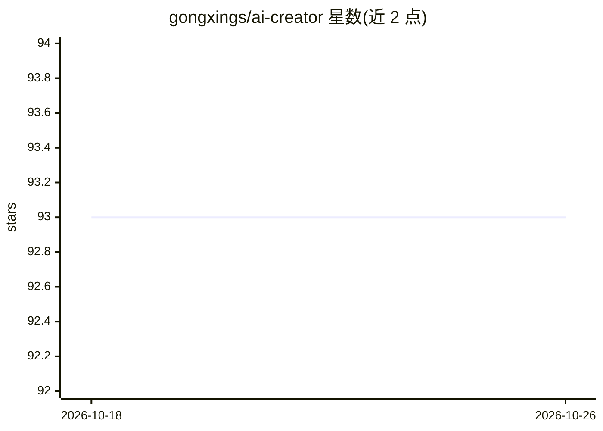

# gongxings/ai-creator

⭐ 93 · Python · MIT · 推送 2026-05-13 · [GitHub](https://github.com/gongxings/ai-creator) · [官网](http://ai-creator.biyebang.com.cn) · 个人维护 · 中文 README

**面向内容创作者的 AI 创作 Web 平台：写作/图片/视频/PPT 生成与多平台发布**

全栈 Web 应用，为内容创作者提供 AI 生成工具集：14 个写作工具（公众号文章、小红书笔记、公文、论文等）、文本生图与 AI 编辑、文/图转视频与 AI 配音、PPT 主题与大纲生成，并支持一键发布到微信公众号、小红书、抖音、快手、今日头条。后端 FastAPI + MySQL + Redis，前端 Vue 3 + TypeScript，支持 Docker 部署，接入 OpenAI、Claude、通义千问、文心一言、智谱AI 多模型，并含积分会员计费系统。README 自述持续迭代中，需 Python 3.13+/Node.js 22+/MySQL 8.0+/Redis 6.0+。

## 筛选速览

| 维度 | 判定 | 备注 |
|---|---|---|
| AI 角色 | `ai-native` | 本体是模型或模型工具 |
| 许可风险 | `permissive` | MIT |
| 部署形态 | `self-host` | docker 或自建部署 |
| 模型依赖 | locked-api |  |
| 硬件要求 | — | 无带数字的原话,不猜 |
| 安装摩擦 | `low` | 无编译、无系统依赖或容器化 |
| 成熟度 | `idea` | |

## 能力要点

- 14 个专业写作工具（公众号/小红书/公文/论文/营销文案等）
- 文本生图、文/图转视频、AI 配音、PPT 在线编辑
- 一键发布到微信公众号、小红书、抖音、快手、今日头条
- 支持 OpenAI、Claude、通义千问、文心一言、智谱AI 多模型

## 适用场景

- 生成公众号文章或小红书笔记等社媒内容
- 用 AI 生成配图、短视频或 PPT
- 创作后一键发布到多个内容平台

## 场景标签

`AI 写作` `图像生成` `视频生成` · 领域:内容生成

## 证据(README 行号)

> L11: 一个功能强大的AI创作平台，提供AI写作、图片生成、视频生成、PPT生成等创作工具，并支持一键发布到多个平台。正在持续迭代。。。。。
> L15: - **14个专业写作工具**：公众号文章、小红书笔记、公文、论文、营销文案等
> L19: - **一键发布**：微信公众号、小红书、抖音、快手、今日头条

## 星数曲线

2026-10-18 93 → 2026-10-26 93（+0）

---
*卡片 v1 · prompt 1.4 · 生成 2026-10-23 · 置信度 high · 依据 README sha `5e8764bd2769` · [字段定义](../../DATASET.md)*
