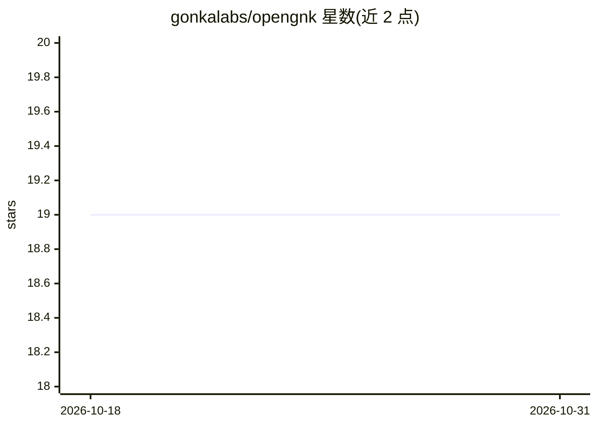

# gonkalabs/opengnk

⭐ 19 · Go · 推送 2026-09-21 · [GitHub](https://github.com/gonkalabs/opengnk) · 组织维护

**把 Gonka 去中心化推理网络封装为 OpenAI 兼容 API 的代理**

基于 Docker 的 Go 代理服务，将 Gonka AI 去中心化推理网络（DevShards 链上托管机制）暴露为标准 OpenAI 兼容 REST API，支持 /v1/chat/completions 流式与非流式、原生与模拟工具调用、隐私脱敏（转发前剥离敏感数据并在响应中还原）。提供三种上游模式：devshard（经 OpenBroker 公共代理）、devshard-embedded（自托管网关，需白名单钱包与 GNK 托管资金）、node（已弃用的 ECDSA 直连模式）。面向希望用 OpenAI SDK/协议接入低成本推理的开发者。

## 筛选速览

| 维度 | 判定 | 备注 |
|---|---|---|
| AI 角色 | `ai-ecosystem` | LLM/agent 周边工具 |
| 许可风险 | `none` | — |
| 部署形态 | `self-host` | docker 或自建部署 |
| 模型依赖 | — | README 未给出锁定关系 |
| 硬件要求 | — | 无带数字的原话,不猜 |
| 安装摩擦 | `low` | 无编译、无系统依赖或容器化 |
| 成熟度 | — | 结构信号不足 |

## 能力要点

- OpenAI 兼容 API，任何支持自定义 base_url 的应用可直接接入
- 工具调用模拟：将 tool-call 请求改写为普通提示并在响应中还原
- 隐私脱敏：剥离 API key/邮箱/姓名/卡号等敏感数据后再转发
- 内置 Web 聊天界面与请求质量指标端点

## 适用场景

- 让现有 OpenAI SDK 应用不改代码切换到 Gonka 推理网络
- 经 OpenBroker 无钱包白名单低成本调用 LLM
- 在敏感数据场景下对外发推理请求前自动脱敏

## 场景标签

`模型网关` · 领域:Agent 开发

## 证据(README 行号)

> L3: A lightweight, Docker-based proxy that exposes the Gonka AI decentralised inference network as a standard **OpenAI-c
> L7: The Gonka network uses **DevShards** — on-chain escrows that fund inference against AI models. The proxy connects to
> L146: The proxy exposes the same API as OpenAI. Any library or application that supports a custom `base_url` will work.

## 星数曲线

2026-10-18 19 → 2026-10-31 19（+0）

---
*卡片 v1 · prompt 1.4 · 生成 2026-10-28 · 置信度 high · 依据 README sha `24cf1162f189` · [字段定义](../../DATASET.md)*
