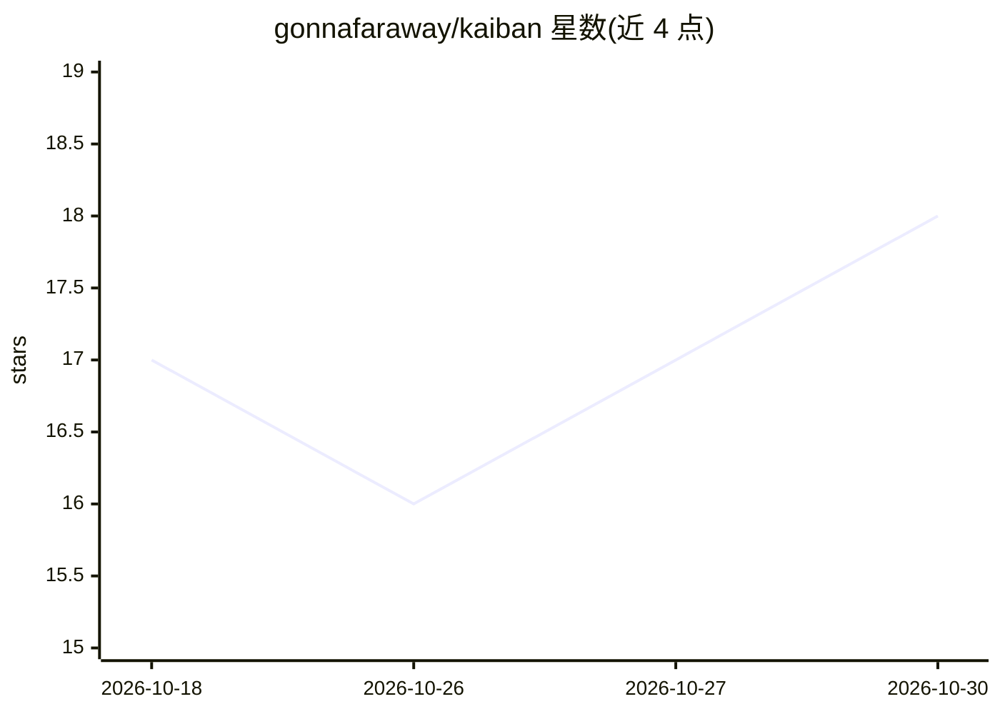

# gonnafaraway/kaiban

⭐ 18 · Go · Apache-2.0 · 推送 2026-09-29 · [GitHub](https://github.com/gonnafaraway/kaiban) · 个人维护

**面向单人开发者的本地 AI agent 看板：每列一个角色 agent**

本地优先的开源 Kanban 系统，用于以 LLM agent 流程交付软件：每列对应一个角色（Product、Business Analyst、System Analyst、Developer、QA、Auto QA），任务在列内运行 agent，流式输出 SSE 日志并生成 markdown 报告，人工审批后方可进入下一列，也可退回。支持任意 OpenAI 兼容 API，可选 Jira/Confluence/GitLab/GitHub 集成与远程 MCP 工具，每任务对应一个 git 分支。一条 docker compose up 即可启动（Go API + Next.js UI + PostgreSQL 16）。非 SaaS、非多租户，面向单机单人使用；RU/EN 双语界面。

## 筛选速览

| 维度 | 判定 | 备注 |
|---|---|---|
| AI 角色 | `ai-native` | 本体是模型或模型工具 |
| 许可风险 | `permissive` | Apache-2.0 |
| 部署形态 | `self-host` | docker 或自建部署 |
| 模型依赖 | — | README 未给出锁定关系 |
| 硬件要求 | — | 无带数字的原话,不猜 |
| 安装摩擦 | `low` | 无编译、无系统依赖或容器化 |
| 成熟度 | — | 结构信号不足 |

## 能力要点

- 每列一个角色 agent，含可编辑系统提示与 overlay 指令
- 人工审批门（Approve）为前进必要条件，或开 Autoplay 全自动流转
- 原生 Jira/Confluence/GitLab/GitHub 集成与远程 MCP 服务器（HTTP/SSE）
- 运行成功后推送任务分支并自动开 MR/PR

## 适用场景

- 个人开发者用看板流程管理从产品到 QA 的 agent 工作流
- 让不同角色 agent 依次产出报告并在人工把关下推进任务
- 本地运行、自带密钥的 agent 开发流程管理

## 场景标签

`多智能体` · 领域:Agent 开发

## 证据(README 行号)

> L26: **Kaiban** is a local Kanban system for shipping software with LLM agents. Each column is a **role** (Product, Busi
> L114: 2. Agent runs an LLM tool-loop (integrations + MCP), streams progress over **SSE**, writes a **markdown report**.

## 星数曲线

2026-10-18 17 → 2026-10-30 18（+1）

---
*卡片 v1 · prompt 1.4 · 生成 2026-10-29 · 置信度 high · 依据 README sha `f71daf64a0ef` · [字段定义](../../DATASET.md)*
