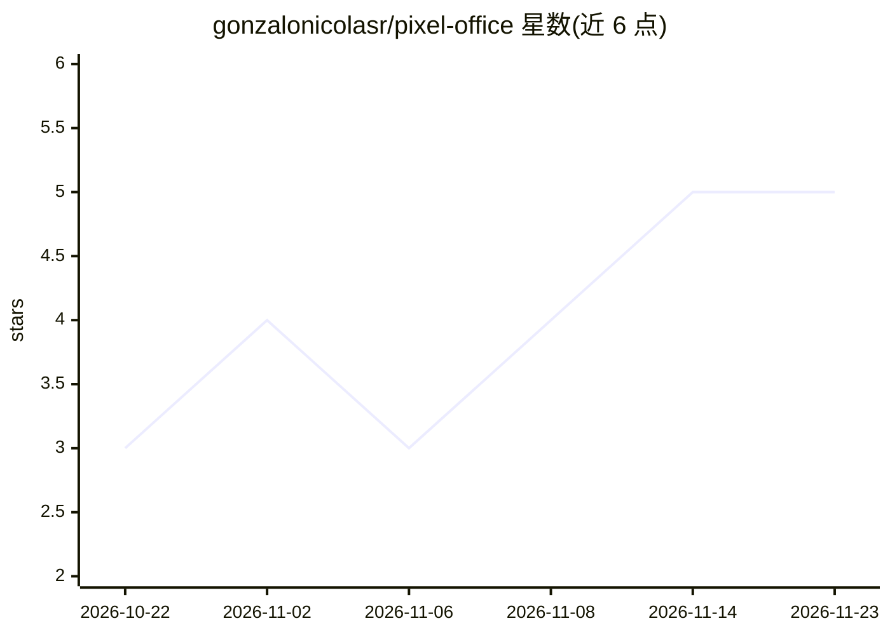

# gonzalonicolasr/pixel-office

⭐ 5 · TypeScript · MIT · 推送 2026-10-18 · [GitHub](https://github.com/gonzalonicolasr/pixel-office) · 个人维护

**像素风办公室里让 AI Agent 团队协作的多 Agent 应用**

一个开源像素风办公室场景应用：用户添加团队成员并为其指定角色、提示词与模型，写入需求后由 lead（★）生成结构化任务计划并分派给各成员并行执行，回答以流式输出呈现在聊天中，角色在办公室里实时打字动画。可为成员开启 PC 工具（读/写/编辑/搜索文件、运行命令），写操作需逐次授权。技术栈为 Node 20+、Three.js、React 19、TypeScript，支持自建办公室背景与 AI 绘制角色立绘。需本地运行，API 默认仅监听 localhost。

## 筛选速览

| 维度 | 判定 | 备注 |
|---|---|---|
| AI 角色 | `ai-native` | 本体是模型或模型工具 |
| 许可风险 | `permissive` | MIT |
| 部署形态 | `library` | 以包/库形式分发 |
| 模型依赖 | local-ok | 支持本地模型 |
| 硬件要求 | — | 无带数字的原话,不猜 |
| 安装摩擦 | `low` | 无编译、无系统依赖或容器化 |
| 成熟度 | — | 结构信号不足 |

## 能力要点

- lead 生成 JSON 计划并按成员分派任务，成员并行处理各自部分
- 每个成员可配置角色、提示词、provider、模型与工位
- PC 工具带权限对话框（Permitir/Siempre/Denegar），写与命令需批准
- 内置无需 key 的 Demo provider，可零配置启动体验

## 适用场景

- 把自己需要做的事拆给多个 AI 成员并行完成
- 让带权限控制的 Agent 在本地工作区执行文件操作
- 用不同 provider（含本地模型）混合搭建一个可视化团队

## 场景标签

`多智能体` · 领域:Agent 开发

## 证据(README 行号)

> L16: **Pixel Office** is an open-source pixel-art office where AI agents work as a team.
> L18: Add people to the office, give each one a **role, a prompt and a model**, and write what you need. The lead reads y
> L27: - **Real routing.** You write to the team; the lead (★) returns a structured plan of who does what, and each assign

## 星数曲线

2026-10-22 3 → 2026-11-23 5（+2）

---
*卡片 v1 · prompt 1.4 · 生成 2026-11-21 · 置信度 high · 依据 README sha `c1a947aefacd` · [字段定义](../../DATASET.md)*
