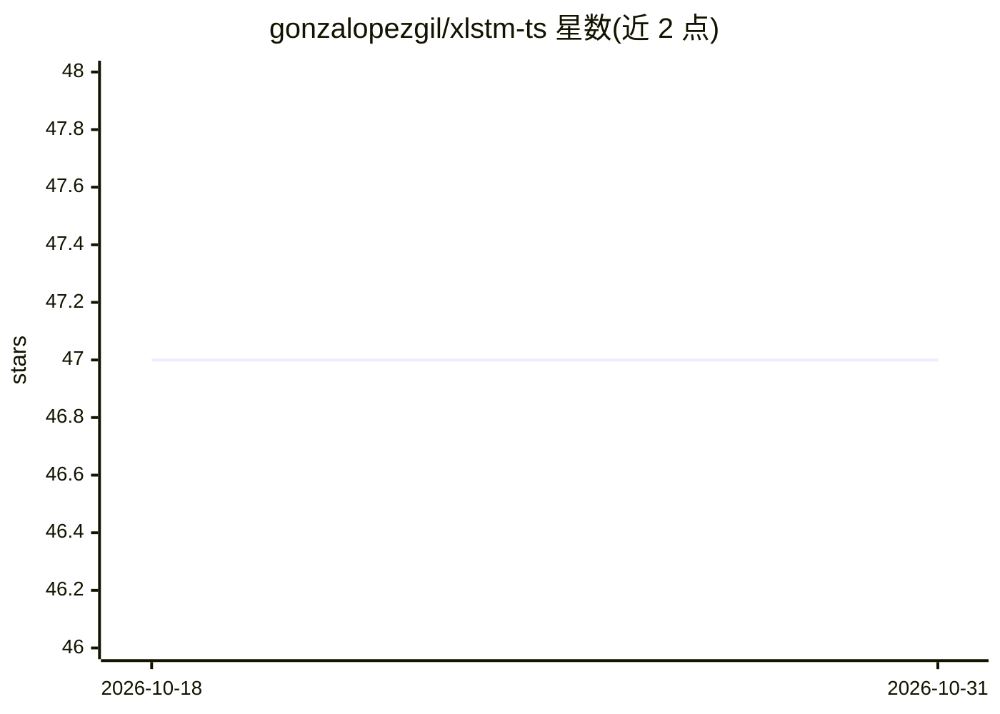

# gonzalopezgil/xlstm-ts

⭐ 47 · Jupyter Notebook · MIT · 推送 2026-05-02 · [GitHub](https://github.com/gonzalopezgil/xlstm-ts) · 组织维护

**面向时间序列预测（含股市趋势）的 xLSTM-TS 模型实现**

论文《An Evaluation of Deep Learning Models for Stock Market Trend Prediction》官方仓库，作者来自都柏林城市大学。核心是将 xLSTM 架构（Beck et al. 2024）改造为适用于时间序列预测的 xLSTM-TS，并集成小波去噪（DWT）预处理；同时实现 TCN、N-BEATS、TFT、N-HiTS、TiDE 五个基准模型，在 S&P 500 与巴西 ETF EWZ 的日线/小时线数据上完成训练与评测（Accuracy、F1、MAE 等）。以 Jupyter notebook 与模块化源码（src/ml）提供，训练需 CUDA GPU，开发测试环境为 Colab + NVIDIA T4；另含一个开发中的 GUI 应用。

## 筛选速览

| 维度 | 判定 | 备注 |
|---|---|---|
| AI 角色 | `ai-native` | 本体是模型或模型工具 |
| 许可风险 | `permissive` | MIT |
| 部署形态 | `library` | 以包/库形式分发 |
| 模型依赖 | — | README 未给出锁定关系 |
| 硬件要求 | — | 无带数字的原话,不猜 |
| 安装摩擦 | `medium` | 含编译或系统依赖之一 |
| 成熟度 | — | 结构信号不足 |

## 能力要点

- xLSTM 架构的时间序列改造实现 xLSTM-TS
- 基于离散小波变换的信号去噪预处理
- 内置 TCN/N-BEATS/TFT/N-HiTS/TiDE 五个基准模型与完整评测流程
- 提供 S&P 500 与 EWZ 日线/小时线数据集及 notebook

## 适用场景

- 复现论文中的股市趋势预测实验
- 在自定义时间序列数据上训练 xLSTM-TS 或基准模型
- 比较多种深度学习预测模型的表现

## 场景标签

`金融量化` `模型评测` · 领域:评测与运维

## 证据(README 行号)

> L8: This repository contains the implementation of the **xLSTM-TS model**, a time series-optimised adaptation of the Ext
> L161: The focus of this repository is the xLSTM-TS model, an adaptation of the **Extended Long Short-Term Memory (xLSTM)

## 星数曲线

2026-10-18 47 → 2026-10-31 47（+0）

---
*卡片 v1 · prompt 1.4 · 生成 2026-10-25 · 置信度 high · 依据 README sha `80f1089b5011` · [字段定义](../../DATASET.md)*
