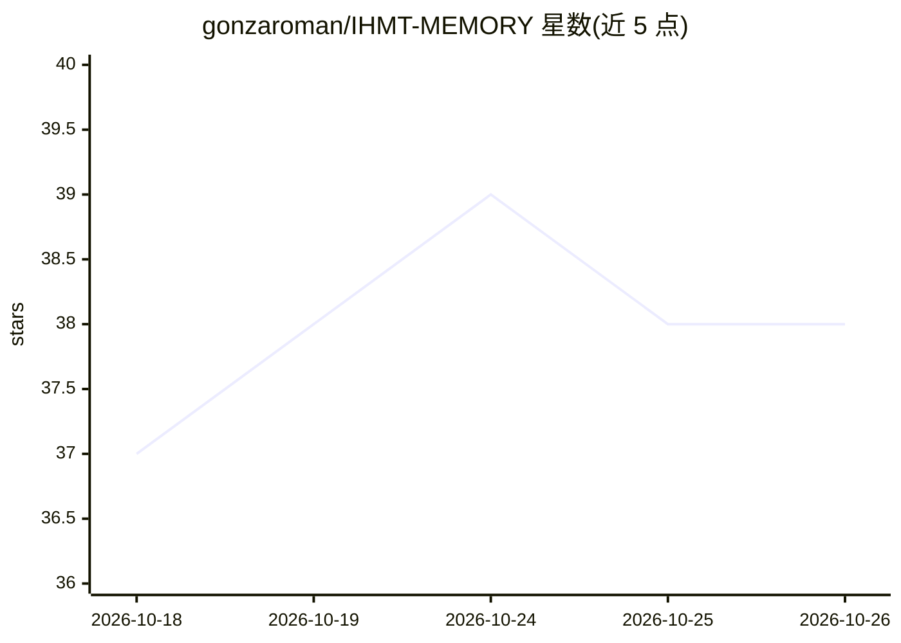

# gonzaroman/IHMT-MEMORY

⭐ 38 · Python · MIT · 推送 2026-10-15 · [GitHub](https://github.com/gonzaroman/IHMT-MEMORY) · [官网](https://github.com/gonzaroman/IHMT-MEMORY) · 个人维护

**给 AI 编码代理的跨会话长期记忆：本地纯文件树 MCP 服务器**

面向 Claude Code、Codex、opencode 等 AI 编码代理的长期记忆系统，以 stdio MCP 服务器形式提供，多个代理可共享同一份记忆。知识存储为本地磁盘上的递归纯文件树（文本叶子 + 递归 JSON 摘要 + root.json），检索沿树下行（beam × log_B(n) 次文件读取），无需向量数据库；核心仅依赖 Python 3.10+ 标准库，MCP SDK 为可选组件。支持过期事实标记（OUTDATED）、歧义询问、双语图形界面；官方支持 Claude Code，Codex 与 opencode 已测试，Windows 指南包含但未测试。

## 筛选速览

| 维度 | 判定 | 备注 |
|---|---|---|
| AI 角色 | `ai-ecosystem` | LLM/agent 周边工具 |
| 许可风险 | `permissive` | MIT |
| 部署形态 | `library` | 以包/库形式分发 |
| 模型依赖 | — | README 未给出锁定关系 |
| 硬件要求 | — | 无带数字的原话,不猜 |
| 安装摩擦 | `low` | 无编译、无系统依赖或容器化 |
| 成熟度 | — | 结构信号不足 |

## 能力要点

- 记忆以纯文本文件树存储，可复制、备份、版本控制，无云无数据库
- 检索走树结构（beam × log_B(n) 文件读取），典型返回 200–900 tokens
- 多个代理（Claude Code/Codex/opencode 等）共享同一份记忆
- 过期事实自动标记 OUTDATED，歧义查询返回候选而非猜测

## 适用场景

- 让编码代理记住我的决策、环境与纠错，跨会话跨项目复用
- 多个 AI 编码工具共享同一份长期记忆
- 本地私有存储记忆并可用 GUI 浏览与诊断检索过程

## 场景标签

`Agent 记忆` · 领域:Agent 开发

## 证据(README 行号)

> L6: **Long-term memory for your AI coding agents.** Tell your agent something once — a decision, how
> L35: > (setup). IHMT is a standard stdio MCP server, so any
> L150: A universal, domain-agnostic long-term memory for LLMs, stored as a recursive tree of plain files on

## 星数曲线

2026-10-18 37 → 2026-10-26 38（+1）

---
*卡片 v1 · prompt 1.4 · 生成 2026-10-25 · 置信度 high · 依据 README sha `d97fe48cc7d3` · [字段定义](../../DATASET.md)*
