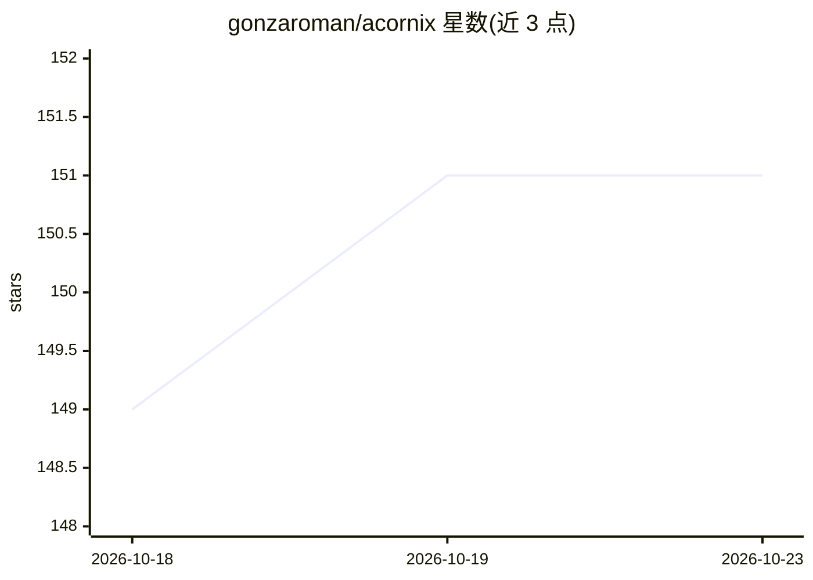

# gonzaroman/acornix

⭐ 151 · Kotlin · MIT · 推送 2026-10-18 · [GitHub](https://github.com/gonzaroman/acornix) · [官网](https://github.com/gonzaroman/acornix/releases/latest) · 个人维护

**安卓端 AI 应用生成器与手机助手：用文字/语音/照片创建应用**

原生 Android 应用：用户自带 API key，通过文字、语音或参考照片让 AI 生成移动端 Web 应用，实时编写并可迭代改进；生成的应用全屏离线运行、可添加到主屏幕、各自拥有独立 SQLite 数据库。另含手机助手（调用工具、可选无障碍服务实现跨应用点击输入）、类 macOS 桌面环境 AcornixOS、ZIP 备份导入导出与免 API key 的手动工作室。支持 Anthropic/OpenAI/Gemini 及任意 OpenAI 兼容端点，Android 8.0+，APK 安装。

## 筛选速览

| 维度 | 判定 | 备注 |
|---|---|---|
| AI 角色 | `ai-native` | 本体是模型或模型工具 |
| 许可风险 | `permissive` | MIT |
| 部署形态 | `None` |  |
| 模型依赖 | local-ok | 支持本地模型 |
| 硬件要求 | — | 无带数字的原话,不猜 |
| 安装摩擦 | `low` | 无编译、无系统依赖或容器化 |
| 成熟度 | — | 结构信号不足 |

## 能力要点

- 文字/语音/照片生成应用，实时展示编码过程并支持迭代版本
- 每个应用独立沙箱 origin 与 SQLite 数据库，可离线全屏运行
- 手机助手可调用工具操作设备，可选无障碍服务跨应用点击输入
- AcornixOS 桌面环境（窗口/Dock/Launchpad）

## 适用场景

- 在手机上让 AI 帮我快速做出小游戏或小工具
- 让 AI 助手帮忙定闹钟、搜视频、操作其他应用
- 把生成的应用放到主屏幕当正常应用离线使用

## 场景标签

`AI 助手` `代码生成` `GUI 自动化` · 领域:效率与自动化

## 证据(README 行号)

> L5: **Vibe coding in your pocket.** Describe an app, a game or a tool, and watch the AI write it live. Seconds later it 
> L18: Acornix turns your phone into a place where software gets made. You bring an API key from your favourite AI (Claude
> L34: Type what you want, dictate it 🎙️ or attach a reference photo 📎 ("make an app like this"). Pick a type (game, utili

## 星数曲线

2026-10-18 149 → 2026-10-23 151（+2）

---
*卡片 v1 · prompt 1.4 · 生成 2026-10-22 · 置信度 high · 依据 README sha `786e4d5583a7` · [字段定义](../../DATASET.md)*
