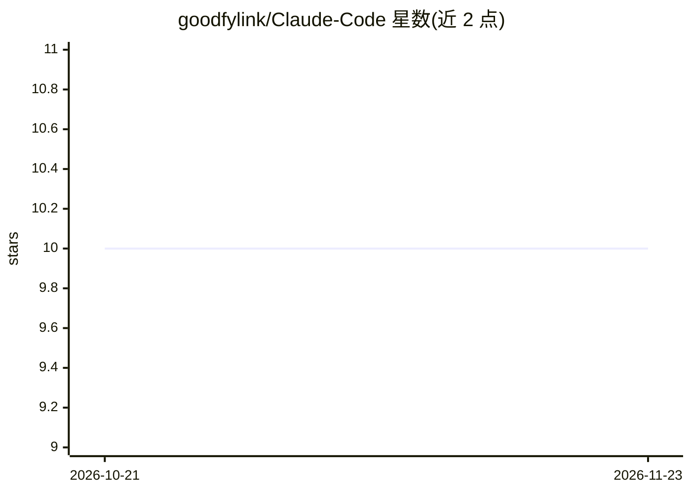

# goodfylink/Claude-Code

⭐ 10 · TypeScript · 推送 2026-04-02 · [GitHub](https://github.com/goodfylink/Claude-Code) · 个人维护 · 中文 README

**Claude Code 2.1.88 的恢复源码工程，可构建并启动 CLI**

基于公开 npm 发布包和 source map 恢复出的 Claude Code 2.1.88 源码工程，包含 CLI 主入口、REPL 交互链、工具注册表（Bash/文件读写/WebFetch 等 12 项）、斜杠命令注册表、权限与 Hook 系统、会话恢复与自动压缩等模块。定位为源码恢复、工程修复与技术分析用途，声明不代表官方原始内部仓库；部分模块为恢复期补写的兼容实现，受 feature gate 控制的路径尚未完成端到端验证。要求 Node.js >= 18，通过 npm 脚本构建并运行产物。

## 筛选速览

| 维度 | 判定 | 备注 |
|---|---|---|
| AI 角色 | `ai-ecosystem` | LLM/agent 周边工具 |
| 许可风险 | `none` | — |
| 部署形态 | `None` |  |
| 模型依赖 | — | README 未给出锁定关系 |
| 硬件要求 | — | 无带数字的原话,不猜 |
| 安装摩擦 | `low` | 无编译、无系统依赖或容器化 |
| 成熟度 | `idea` | |

## 能力要点

- 从 npm 包与 source map 恢复的 Claude Code 2.1.88 源码，可完整构建并启动 CLI
- 包含 12 项工具注册与 16 条斜杠命令的源码实现
- 区分已运行验证（--help/--version）与仅源码层确认的能力
- 声明部分模块为恢复期兼容实现，非原始私有实现

## 适用场景

- 审阅和研究 Claude Code 的源码实现细节
- 在源码层面修复、补齐构建链并进行提交
- 对 CLI 构建产物进行本地构建与启动测试

## 场景标签

`编码 Agent` · 领域:编码与开发

## 证据(README 行号)

> L7: 这并不是官方原始内部仓库，而是基于公开 npm 发布包和 source map 恢复出的 Claude Code `2.1.88` 源码工程，并在此基础上继续补齐缺失文件、修复构建链，以及补上一部分运行时兼容实现。
> L93: - REPL 交互主链
> L104: - 本地 UDS 消息链路

## 星数曲线

2026-10-21 10 → 2026-11-23 10（+0）

---
*卡片 v1 · prompt 1.4 · 生成 2026-11-19 · 置信度 high · 依据 README sha `a301bb364885` · [字段定义](../../DATASET.md)*
