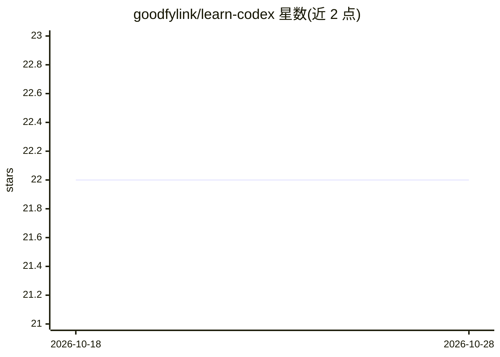

# goodfylink/learn-codex

⭐ 22 · Rust · 推送 2026-04-11 · [GitHub](https://github.com/goodfylink/learn-codex) · 个人维护 · 中文 README

**逐步讲解如何搭建 Codex 风格 agent harness/runtime 的 Rust 教学项目**

以教程形式拆解 agent harness 的演进：从最小 function-calling 循环、工具注册、规划、子代理委派，到技能加载与上下文压缩、并行工具调用、带角色与层级的多 agent team，共 9 个阶段的 Rust 示例代码，另有合并版主实现（src/main.rs、sandbox.rs、agent_team.rs）。通过 OpenAI 兼容的环境变量配置模型端点，cargo run 启动后以对话方式下达任务。README 自述为教学用实现而非生产级 runtime，上下文压缩、安全策略、权限边界等均为简化版。

## 筛选速览

| 维度 | 判定 | 备注 |
|---|---|---|
| AI 角色 | `ai-knowledge` | 知识聚合/清单类 |
| 许可风险 | `none` | — |
| 部署形态 | `None` |  |
| 模型依赖 | — | README 未给出锁定关系 |
| 硬件要求 | — | 无带数字的原话,不猜 |
| 安装摩擦 | `low` | 无编译、无系统依赖或容器化 |
| 成熟度 | `idea` | |

## 能力要点

- 9 阶段 Rust 示例：从最小 agent loop 到带角色/层级/上下文继承的 agent team
- 工具注册表、并行工具调用、sub-agent 委派、skill 注入与上下文压缩
- 主实现合并 step05-09 能力，cargo run 即可运行
- README 明确列出当前简化点与教学级限制

## 适用场景

- 学习 coding agent harness/runtime 的分层结构与演进
- 参考实现理解 Codex 类系统的 team、委派与沙箱机制
- 按阶段阅读源码并本地运行对话式 agent 实验

## 场景标签

`教程课程` · 领域:学习与行业

## 证据(README 行号)

> L23: 这也是为什么这个项目不会把重点放在“怎么写更长的 prompt”，而是放在“如何逐步搭出一个像 Codex 的 harness/runtime”。
> L237: 这个项目的意义，就是把这条演进线拆成可单独理解的步骤。
> L246: 而 `src/examples` 负责按阶段讲清楚能力是怎么长出来的。

## 星数曲线

2026-10-18 22 → 2026-10-28 22（+0）

---
*卡片 v1 · prompt 1.4 · 生成 2026-10-27 · 置信度 mid · 依据 README sha `4c915fb31fb4` · [字段定义](../../DATASET.md)*
