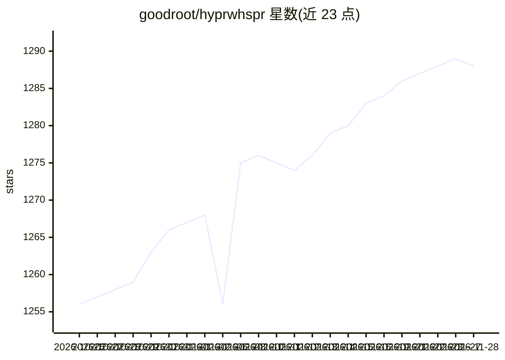

# goodroot/hyprwhspr

⭐ 1,288 · Python · MIT · 推送 2026-11-26 · [GitHub](https://github.com/goodroot/hyprwhspr) · [官网](https://hyprwhspr.com) · 个人维护

**Linux 全系统级离线语音听写工具：按键说话转文字**

面向 Linux 桌面的系统级语音转文字（dictation）工具，通过全局快捷键录制语音并将转录文本自动粘贴到任意活动输入框。支持本地推理（onnx-asr、内存中模型、Whisper.cpp CPU 路径）与可选云 API 后端；支持翻译为英文、CJK 识别、流式转录（实验性）、词表覆盖与自定义快捷键。提供 AUR、安装脚本、Nix flake 与源码安装，CLI 覆盖模型管理、录音控制与文件转写。依赖 systemd、Python 3.11-3.15 及 Wayland/X11 会话。

## 筛选速览

| 维度 | 判定 | 备注 |
|---|---|---|
| AI 角色 | `ai-native` | 本体是模型或模型工具 |
| 许可风险 | `permissive` | MIT |
| 部署形态 | `None` |  |
| 模型依赖 | locked-api |  |
| 硬件要求 | — | 无带数字的原话,不猜 |
| 安装摩擦 | `low` | 无编译、无系统依赖或容器化 |
| 成熟度 | — | 结构信号不足 |

## 能力要点

- 本地离线转录，云 API 完全可选
- 多后端：Parakeet TDT V3、Qwen3-ASR、Whisper、Cohere、ElevenLabs、REST API
- onnx-asr 针对 CPU 速度优化，支持限制或零 GPU 内存占用
- 转录文本自动粘贴到活动缓冲区，带主题可视化器与音频闪避（可选）

## 适用场景

- 在 Hyprland/GNOME 等 Linux 桌面上按快捷键随时语音输入
- 无需 GPU 的机器上用 CPU 做语音听写
- 用 Qwen3-ASR 进行中日韩语音输入
- 将录音文件用 CLI 转写为文本

## 场景标签

`语音识别` · 领域:感知与多模态

## 证据(README 行号)

> L3:  Native speech-to-text for Linux - Fast, accurate, private and hackable system-wide dictation
> L15: - **Offline and private** - Transcription never leaves your machine. Cloud APIs are fully optional.

## 星数曲线

2026-10-26 1,256 → 2026-11-28 1,288（+32）

---
*卡片 v1 · prompt 1.4 · 生成 2026-11-26 · 置信度 high · 依据 README sha `c1839823131e` · [字段定义](../../DATASET.md)*
