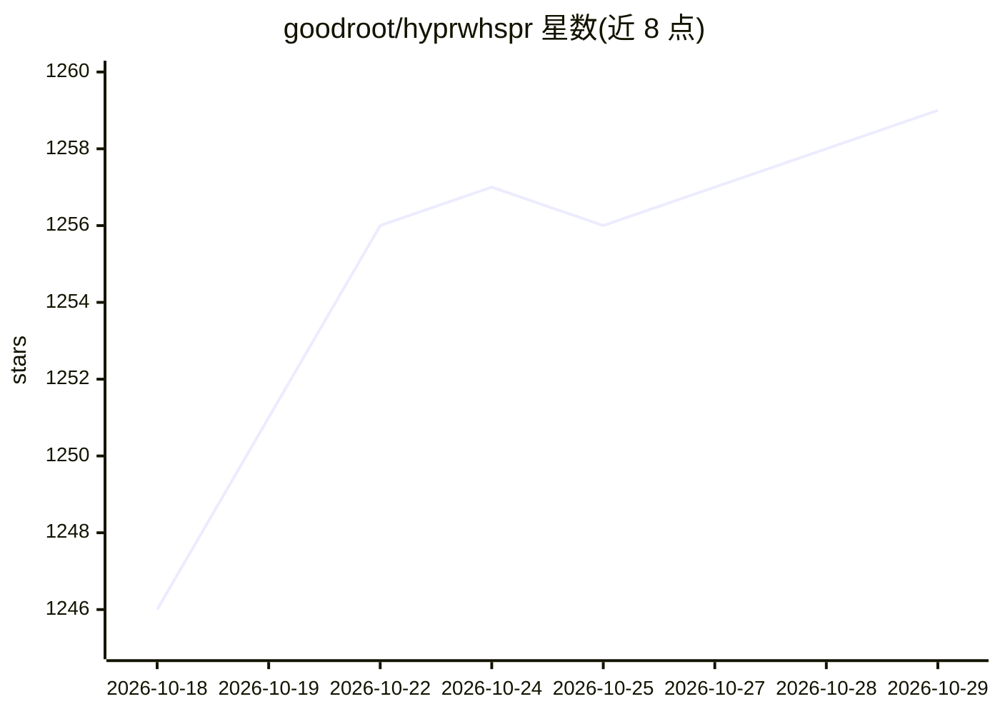

# goodroot/hyprwhspr

⭐ 1,259 · Python · MIT · 推送 2026-10-25 · [GitHub](https://github.com/goodroot/hyprwhspr) · [官网](https://hyprwhspr.com) · 个人维护

**Linux 原生系统级语音听写工具，本地语音转文字**

面向 Linux 桌面用户的系统级语音听写应用：按键触发录音，将语音转录为文字并自动粘贴到任意活动输入框。默认使用内存中的本地模型离线转录，支持 Cohere Transcribe、Parakeet TDT V3、Whisper、Qwen3-ASR、REST API 或实时 WebSocket 作为后端；Qwen3-ASR 面向中日韩语言，onnx-asr 用于 CPU 加速，可选 CUDA/Vulkan GPU 加速，云端 API 为可选项。提供 AUR 包、安装脚本、源码安装与 Nix flake（beta）等安装途径，附带 CLI 管理模型、配置与 systemd 服务。

## 筛选速览

| 维度 | 判定 | 备注 |
|---|---|---|
| AI 角色 | `ai-native` | 本体是模型或模型工具 |
| 许可风险 | `permissive` | MIT |
| 部署形态 | `None` |  |
| 模型依赖 | locked-api |  |
| 硬件要求 | — | 无带数字的原话,不猜 |
| 安装摩擦 | `low` | 无编译、无系统依赖或容器化 |
| 成熟度 | — | 结构信号不足 |

## 能力要点

- 多转录后端：Cohere Transcribe / Parakeet TDT V3 / Whisper / Qwen3-ASR / REST API / WebSocket
- 默认本地离线转录，云端 API 完全可选
- Qwen3-ASR 支持中/日/韩，onnx-asr 优化 CPU 速度
- 自动粘贴到任意活动输入框，支持 Wayland 与 X11

## 适用场景

- Linux 桌面上系统级语音听写，替代打字
- 中日韩等多语言语音输入
- 离线隐私优先的本地转录（也可转录 WAV/MP3 文件）

## 场景标签

`语音识别` · 领域:感知与多模态

## 证据(README 行号)

> L3:  Native speech-to-text for Linux - Fast, accurate, private and hackable system-wide dictation
> L93: 1. ✅ Configure transcription backend (Cohere Transcribe, Parakeet TDT V3, Whisper, Qwen3-ASR, REST API, or Realtime

## 星数曲线

2026-10-18 1,246 → 2026-10-29 1,259（+13）

---
*卡片 v1 · prompt 1.4 · 生成 2026-10-21 · 置信度 high · 依据 README sha `95a356c795c9` · [字段定义](../../DATASET.md)*
